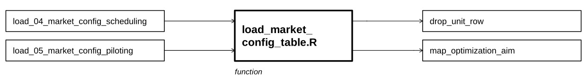

# load_market_config_table.R

**Function** &nbsp;·&nbsp; `30_Simulation/03_Functions/load_market_config_table.R`

## Function

Reads a market configuration table (scheduling or piloting) and:

- validates that it has the required columns and at least one market row
- drops the units row, the first row under the header, with drop_unit_row(), which stops when that row holds data
- returns the resulting data frame

## Called by

- [load_04_market_config_scheduling.R](load_04_market_config_scheduling.md)
- [load_05_market_config_piloting.R](load_05_market_config_piloting.md)

## What it calls, in order of appearance

- [drop_unit_row.R](drop_unit_row.md)
- [map_optimization_aim.R](map_optimization_aim.md)

## Input data

- path      : Character. Path to the market config CSV file.
- file_name : Character. Base name of the file, used in error messages (e.g. "04_Market_config_scheduling.csv").
- market_resolution : Numeric scalar. Market slot length in minutes (parameters$market$market_resolution), used to resolve each market's bid time into a slot for the one-market- per-slot check.

## Output data

- Data frame. The market configuration table, without its units row, and these columns plus any others present in the file:
    - Market
    - closure
    - begin
    - end
    - end_optimization
    - aim

## Other notes from the file header

### One market per slot

Every row of the table describes a market that clears once a day, at an offset of (begin - closure) hours from midnight. Two rows whose bid times fall inside the same market-resolution slot would be two markets of the same role clearing at the same moment, which the rest of the pipeline cannot represent: build_market_timeline() writes each market's timeline onto the Main_df row of its bid time, so the second one silently overwrites the first, and prepare_economic_analysis() keeps a single row per (slot, market type), so their flows would be merged and the identity of one of them lost. This is rejected here, at read time, rather than left to surface as a wrong number later. The check is per file, so it enforces exactly "no two Scheduling markets in one slot" and "no two Piloting markets in one slot"; a Scheduling and a Piloting market sharing a slot is legitimate and is resolved by the attribution rule in prepare_economic_analysis().

### Code outline

1. Read the CSV file
2. Validate non-empty content and required columns
3. Drop the units row
4. Validate at least one market row remains
5. Validate column types and ranges (numeric closure/begin/end/ end_optimization, valid aim codes)
6. Validate that no two markets share a market-resolution slot

### Usage instructions

market_config_df <- load_market_config_table(paths$market_config_scheduling_file, "04_Market_config_scheduling.csv", parameters$market$market_resolution)

## Diagram

Also available as [load_market_config_table.svg](load_market_config_table.svg).

---

[Back to the code structure index](../Code_Structure.md)
