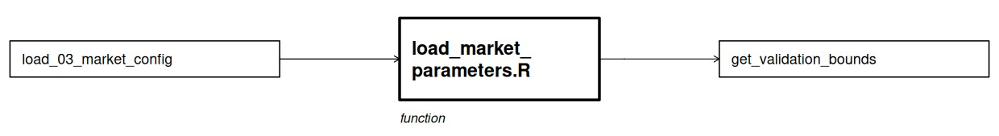

# load_market_parameters.R

**Function** &nbsp;·&nbsp; `30_Simulation/03_Functions/load_market_parameters.R`

## Function

This function structures the already-parsed market-related parameters (as read and validated by read_and_validate_parameter_csv() from 03_Market_config.csv) into a validated named list, clamping the six horizons to the bounds declared in Validation_Market_Config.csv.

## Called by

- [load_03_market_config.R](load_03_market_config.md)

## What it calls, in order of appearance

- [get_validation_bounds.R](get_validation_bounds.md)

## Input data

- values : Named list. Raw parameter/value pairs for market parameters, as returned by read_and_validate_parameter_csv().
- market_validation_config : Data frame. Content of Validation_Market_Config.csv, holding the admissible bounds of the six optimization/implementation/anticipation horizons.

## Output data

- Named list with the elements:
    - market_resolution
    - Complex_Market_Config
    - Optimization_horizon_scheduling
    - Implementation_horizon_scheduling
    - Anticipation_scheduling
    - optimization_aim_scheduling
    - Optimization_horizon_piloting
    - Implementation_horizon_piloting
    - Anticipation_piloting
    - optimization_aim_piloting
    - Max_flex_periods_day
    - Max_flex_com_price
    - Max_flex_exec_price
    - Max_flex_period_duration
    - Max_flex_probability_down
    - Max_flex_probability_up

## Other notes from the file header

### Why the horizons are clamped and not rejected

A horizon longer than the market process can resolve, or shorter than one hour, would leave the optimization without a well-formed window rather than with a wrong number. The bounds are therefore applied, not merely reported, and the console states every value that was moved. The bounds themselves live in Validation_Market_Config.csv: this function holds none of them.

### Usage instructions

```r
params <- load_market_parameters(raw_values, market_validation_config)
```

### Code outline

1. Separate the text parameters from the numeric ones.
2. Coerce the numeric ones and name each of them.
3. Return them as the market sub-list.

### Exceptions and special cases

- The relations between horizons (implementation not longer than optimization, anticipation shorter than implementation) are structural, not numeric limits, and are applied here rather than read from the validation file.

## Diagram



Also available as [load_market_parameters.svg](load_market_parameters.svg).

---

[Back to the code structure index](../Code_Structure.md)
