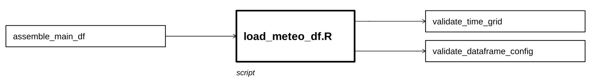

# load_meteo_df.R

**Script** &nbsp;·&nbsp; `30_Simulation/04_Scripts/load_meteo_df.R`

## Function

Loads Meteo_df (weather input data: Text, SolarR) from disk and validates it before it is used by assemble_main_df.R.

## Called by

- [assemble_main_df.R](assemble_main_df.md)

## What it calls, in order of appearance

- [validate_time_grid.R](validate_time_grid.md)
- [validate_dataframe_config.R](validate_dataframe_config.md)

## Input data

- paths$meteo_file            : Character. Path to Meteo_df.rds.
- paths$meteo_validation_file : Character. Path to Validation_Meteo_df.csv.

## Output data

- Meteo_df       : Data frame, with the columns:
    - time (POSIXct)
    - Text
    - SolarR
- meteo_step_sec : Numeric. Detected step (seconds) of Meteo_df$time.

## Other notes from the file header

### Code outline

1. Check that Meteo_df.rds exists and read it
2. Validate required columns are present and numeric
3. Validate the time grid (equispaced, compatible with Main_df's resolution)
4. Validate column ranges against Validation_Meteo_df.csv

### Usage instructions

```r
source(file.path("30_Simulation", "04_Scripts", "load_meteo_df.R"))
```

Not called: sourced by assemble_main_df.R while it builds Main_df out of the input series.

## Diagram



Also available as [load_meteo_df.svg](load_meteo_df.svg).

---

[Back to the code structure index](../Code_Structure.md)
