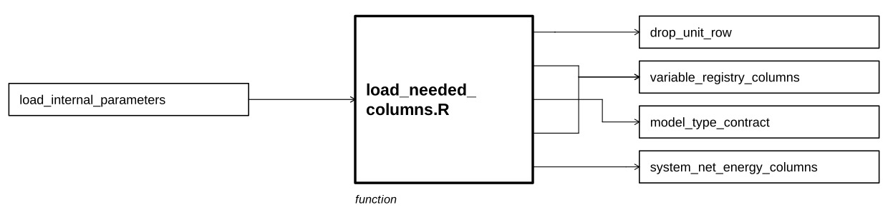

# load_needed_columns.R

**Function** &nbsp;·&nbsp; `30_Simulation/03_Functions/load_needed_columns.R`

## Function

Loads the list of the columns of the simulation data, 02_Needed_cols.csv, and validates it against the parameter catalogue. It is the one list of those columns:

- the row @System_variables_df stands for every column of System_variables_df, and the row @<type>_variables_df (for example @Building_variables_df) for every column of the variable registry of that type of model. Each registry is read from where its type says (the operation variable_registry of model_type_contract()), so the columns are declared there only;
- the stage of each column says whether the assembled table must hold it (assembly), which validate_Main_df() and validate_asset_df() check, whether the preparation of the run adds it (preparation), or whether it is an input of the assets of a type (input): a column of Main_df that the table of every asset of the type holds a copy of during the whole run;
- the table of each column says whether it is a column of Main_df (system) or of the table of the assets of a type of model (the name of the type, for example Building). Each type has its own list of columns.

The table of an asset holds time too, the key of its rows, which is a column of Main_df in the file. A column may be in both Main_df and the table of a type only when it is the net electricity of the system in an itinerary (system_net_energy_columns()), or an input of the type. Main_df holds the sum over the assets of the net electricity the table of each asset holds, and an input is the same column in both tables. The order of the file is the order of the output tables: Main_df_computed takes the columns of Main_df in it, and the table of each asset takes time and then the columns of its type. The pieces the markets work on join them in that order, with a column that several tables hold once.

## Called by

- [load_internal_parameters.R](load_internal_parameters.md)

## What it calls, in order of appearance

- [drop_unit_row.R](drop_unit_row.md)
- [variable_registry_columns.R](variable_registry_columns.md) &nbsp;(2 call sites)
- [model_type_contract.R](model_type_contract.md)
- [system_net_energy_columns.R](system_net_energy_columns.md)

## Input data

- needed_cols_path  : Character. Path to 02_Needed_cols.csv, a table with the columns column, stage and table, and a units row.
- paths             : List. The paths of the simulator. It holds the variable registry of the system, paths$system_variables_file, and the registries of the types of model, which the contract of each type names.
- validation_config : Named list. The parameter catalogue, as load_parameter_catalogue() returns it. Its options for the table column are system and the types of model.

## Output data

- Named list:
    - all            : Character vector. Every column of Main_df, in the order of the file.
    - assembly       : Character vector. The columns of Main_df of stage assembly, in the same order.
    - asset          : Named list, one element per type of model. Each one is a character vector: every column of the table of an asset of the type, time first, then in the order of the file.
    - asset_assembly : Named list, one element per type of model. Each one is a character vector: the columns of that table of stage assembly, time included.
    - joined         : Character vector. Every column of Main_df and of the tables of every type, once, in the order of the file, the order of the pieces the markets work on.
    - asset_input    : Named list, one element per type of model. Each one is a character vector: the inputs of the type (stage input), in the order of the file. They are in asset too, and not in asset_assembly.
    - itinerary_variables : Named list, one element per type of model. Each one is a character vector: the variables of the registry of the type expanded into the four itineraries (scenario == "yes"), in registry order.

## Other notes from the file header

### Code outline

1. Read the table and check its columns, its stages and its tables
2. Expand the columns of the registries
3. The columns of each table, and the columns of all

### Usage instructions

```r
needed <- load_needed_columns(
  needed_cols_path  = paths$needed_cols_file,
  paths             = paths,
  validation_config = validation_config
  )
```

### Exceptions and special cases

- A column named twice in the same table, an empty name, a stage or a table outside the options of the catalogue, or a column in both Main_df and the table of a type that is neither the net electricity of the system nor an input of that type stops the run.
- A row of stage input whose table is system, whose column is not a column of Main_df, or whose column is the net electricity of the system stops the run.

## Diagram



Also available as [load_needed_columns.svg](load_needed_columns.svg).

---

[Back to the code structure index](../Code_Structure.md)
