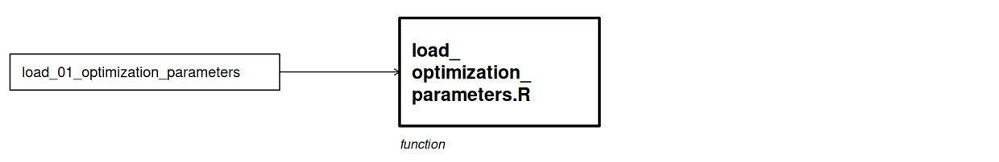

# load_optimization_parameters.R

**Function** &nbsp;·&nbsp; `30_Simulation/03_Functions/load_optimization_parameters.R`

## Function

This function structures the already-parsed optimization hyperparameters for the GA (as read and validated by read_and_validate_parameter_csv() from 01_Optimization_parameters.csv) into a validated named list, clamping out-of-range values.

## Called by

- [load_01_optimization_parameters.R](load_01_optimization_parameters.md)

## What it calls, in order of appearance

- Nothing: this piece calls no other piece of the project.

## Input data

- values : Named list. Raw parameter/value pairs for optimization parameters, as returned by read_and_validate_parameter_csv().

## Output data

- Named list with the elements:
    - population_size
    - iteration_number
    - run_number
    - pcrossover
    - pmutation

## Other notes from the file header

### Usage instructions

```r
params <- load_optimization_parameters(raw_values)
```

### Code outline

1. Separate the text parameters from the numeric ones.
2. Coerce the numeric ones and name each of them.
3. Return them as the optimization sub-list.

## Diagram



Also available as [load_optimization_parameters.svg](load_optimization_parameters.svg).

---

[Back to the code structure index](../Code_Structure.md)
