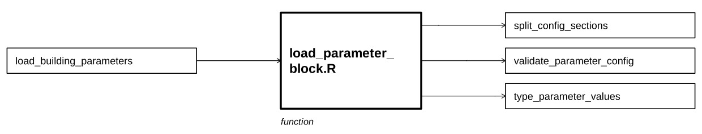

# load_parameter_block.R

**Function** &nbsp;·&nbsp; `30_Simulation/03_Functions/load_parameter_block.R`

## Function

Loads the block of parameters of a configuration file that holds a table below it. The file starts with the header parameter,value,unit, the block runs to the first blank line, and the table follows that line. The block is validated against the rules the parameter catalogue holds for it, as a flat parameter file is, and each value is returned in the type of its rule. In the catalogue, the rows of a file with a table that have a default value are the parameters of its block, and the rows with - are the columns of its table. The columns are not validated here: the script that reads the table does it. The run stops, naming the file, when:

- the file does not start with a block that is closed by a blank line before a table
- a row of the block names a column of the table, which means the blank line that closes the block is missing
- a parameter is duplicated, missing, unknown or invalid

## Called by

- [load_building_parameters.R](load_building_parameters.md)

## What it calls, in order of appearance

- [split_config_sections.R](split_config_sections.md)
- [validate_parameter_config.R](validate_parameter_config.md)
- [type_parameter_values.R](type_parameter_values.md)

## Input data

- path              : Character. Path of the configuration file. Its base name is the one its rules are filed under in the catalogue.
- validation_config : Named list. The parameter catalogue, as load_parameter_catalogue() returns it.

## Output data

- Named list. One element per parameter of the block, in the order of the file, in the type of its rule.

## Other notes from the file header

### Code outline

1. Read the file and split it into its block and its table
2. Separate the rules of the block from those of the table
3. Read the block and check it
4. Give each value the type of its rule

### Usage instructions

```r
deadband <- load_parameter_block(paths$setpoint_mode_file,
  validation_config)
```

## Diagram



Also available as [load_parameter_block.svg](load_parameter_block.svg).

---

[Back to the code structure index](../Code_Structure.md)
