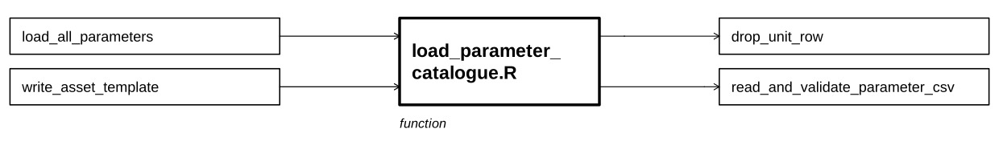

# load_parameter_catalogue.R

**Function** &nbsp;·&nbsp; `30_Simulation/03_Functions/load_parameter_catalogue.R`

## Function

Reads the parameter catalogue, Parameter_catalogue.csv, which holds one row per parameter of the configuration files and per column of their tables: its file, its type, its range or options, what a breach of the rule does, its unit, its description and its default value. The rules every configuration file is validated against are its rows. It also reads the tolerances of that validation, from Validation_tolerances.csv, and checks them against their own rows. The catalogue is checked before it is used: a rule that cannot be applied would let a wrong value through, or stop a right one.

## Called by

- [load_all_parameters.R](load_all_parameters.md)
- [write_asset_template.R](write_asset_template.md)

## What it calls, in order of appearance

- [drop_unit_row.R](drop_unit_row.md)
- [read_and_validate_parameter_csv.R](read_and_validate_parameter_csv.md)

## Input data

- catalogue_path  : Character. Path of Parameter_catalogue.csv.
- tolerances_path : Character. Path of Validation_tolerances.csv.

## Output data

- Named list, the validation configuration every loader receives:
    - rules             : data frame, the catalogue without its units row, every column as text, with the columns:
        - file, parameter, group, block
        - type, min, max, options, output
        - unit, description, default
    - integer_tolerance : numeric, the largest distance to a whole number a value of an Integer parameter may have.

## Other notes from the file header

### Code outline

1. Read the catalogue and drop its units row
2. Check its rules
3. Read the tolerances

### Usage instructions

```r
validation_config <- load_parameter_catalogue(
  paths$parameter_catalogue_file,
  paths$tolerances_validation_file
  )
```

## Diagram



Also available as [load_parameter_catalogue.svg](load_parameter_catalogue.svg).

---

[Back to the code structure index](../Code_Structure.md)
