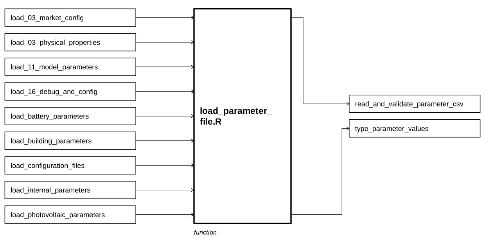

# load_parameter_file.R

**Function** &nbsp;·&nbsp; `30_Simulation/03_Functions/load_parameter_file.R`

## Function

Loads one parameter/value configuration file: it reads the file, validates every value against the rules the parameter catalogue holds for it, and returns each value in the type of its rule. No parameter name is written here: the names are those of the file, and the types those of the catalogue, so adding a parameter is one line of the file and one row of the catalogue.

## Called by

- [load_03_market_config.R](load_03_market_config.md)
- [load_03_physical_properties.R](load_03_physical_properties.md)
- [load_11_model_parameters.R](load_11_model_parameters.md)
- [load_16_debug_and_config.R](load_16_debug_and_config.md)
- [load_battery_parameters.R](load_battery_parameters.md)
- [load_building_parameters.R](load_building_parameters.md)
- [load_configuration_files.R](load_configuration_files.md)
- [load_internal_parameters.R](load_internal_parameters.md)
- [load_photovoltaic_parameters.R](load_photovoltaic_parameters.md)

## What it calls, in order of appearance

- [read_and_validate_parameter_csv.R](read_and_validate_parameter_csv.md)
- [type_parameter_values.R](type_parameter_values.md)

## Input data

- path              : Character. Path of the configuration file. Its base name is the one its rules are filed under in the catalogue.
- validation_config : Named list. The parameter catalogue, as load_parameter_catalogue() returns it.

## Output data

- Named list. One element per parameter, in the order of the file, in the type of its rule.

## Other notes from the file header

### Code outline

1. Read and validate the file
2. Give each value the type of its rule

### Usage instructions

```r
parameters$reward <- load_parameter_file(paths$reward_file,
  validation_config)
```

## Diagram



Also available as [load_parameter_file.svg](load_parameter_file.svg).

---

[Back to the code structure index](../Code_Structure.md)
