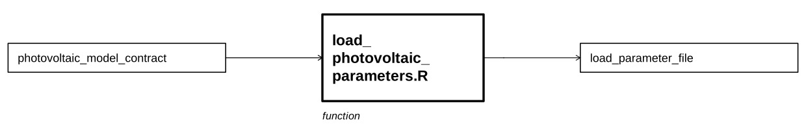

# load_photovoltaic_parameters.R

**Function** &nbsp;·&nbsp; `30_Simulation/05_Models/02_Photovoltaic/03_Functions/load_photovoltaic_parameters.R`

## Function

Loads the parameter groups of one photovoltaic installation. It is the operation load_parameters of the contract of the type Photovoltaic (see model_type_contract()). The installation has one file in its configuration folder, 17_Photovoltaic_parameters.csv, validated against the parameter catalogue as it is read. The reference conditions of the modules (the standard test conditions of the efficiency and the conditions of the NOCT) and the solar constant are common to every installation: they come from the physical properties of the system, and each installation takes a copy, so that its model finds everything it needs in its own entry of parameters$assets.

## Called by

- [photovoltaic_model_contract.R](photovoltaic_model_contract.md)

## What it calls, in order of appearance

- [load_parameter_file.R](load_parameter_file.md)

## Input data

- asset_paths                : List. The paths of the files of the asset, as build_asset_paths() gives them.
- validation_config          : Named list. The parameter catalogue.
- bounding_validation_config : Data frame. Content of Validation_bounding_simulation.csv. Not read.
- parameters                 : List. The parameters of the system already loaded. It must hold physical_properties.

## Output data

- Named list with the groups of the installation, in this order:
- photovoltaic: the 15 parameters of the file:
    - Latitude
    - Longitude
    - Irradiance_time_offset
    - Diffuse_threshold
    - Min_sun_elevation
    - Tilt
    - Azimuth
    - Albedo
    - Module_area
    - Module_efficiency
    - DC_losses
    - Temperature_coefficient
    - NOCT
    - Inverter_efficiency
    - Inverter_power
- reference_conditions: PV_STC_irradiance, PV_STC_cell_temperature, PV_NOCT_irradiance and PV_NOCT_ambient_temperature
- sun: Solar_constant The run stops if one of the reference conditions or the solar constant is missing in parameters$physical_properties.

## Other notes from the file header

### Code outline

1. Load the file of the installation
2. Take the reference conditions of the modules and the solar constant

### Usage instructions

```r
groups <- load_photovoltaic_parameters(
  asset_paths                = asset_paths,
  validation_config          = validation_config,
  bounding_validation_config = bounding_validation_config,
  parameters                 = parameters
  )
```

## Diagram



Also available as [load_photovoltaic_parameters.svg](load_photovoltaic_parameters.svg).

---

[Back to the code structure index](../Code_Structure.md)
