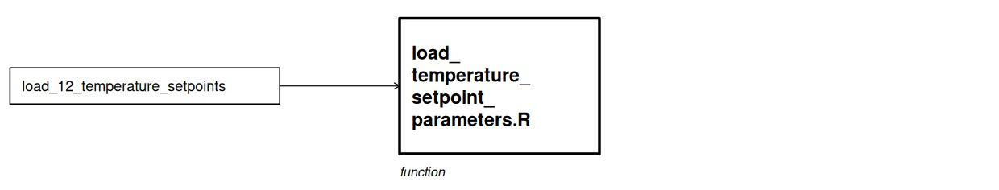

# load_temperature_setpoint_parameters.R

**Function** &nbsp;·&nbsp; `30_Simulation/03_Functions/load_temperature_setpoint_parameters.R`

## Function

Structures the temperature setpoint parameters, as read and validated from 12_Temperature_Setpoints.csv, into the ranges the optimizer may choose each setpoint from. They are only used when control_type is setpoints; they are loaded whatever the control_type, so that a run can switch type without a missing parameter.

## Called by

- [load_12_temperature_setpoints.R](load_12_temperature_setpoints.md)

## What it calls, in order of appearance

- Nothing: this piece calls no other piece of the project.

## Input data

- values : Named list. Raw parameter/value pairs of 12_Temperature_Setpoints.csv:
    - set_point_range_heating_low [degC]
    - set_point_range_heating_high [degC]
    - set_point_range_cooling_low [degC]
    - set_point_range_cooling_high [degC]

## Output data

- Named list:
    - set_point_range_heating : numeric [low, high] [degC]
    - set_point_range_cooling : numeric [low, high] [degC]

## Other notes from the file header

### Code outline

1. Pair each low and high bound into a range.

### Usage instructions

```r
ranges <- load_temperature_setpoint_parameters(raw_values)
```

## Diagram



Also available as [load_temperature_setpoint_parameters.svg](load_temperature_setpoint_parameters.svg).

---

[Back to the code structure index](../Code_Structure.md)
