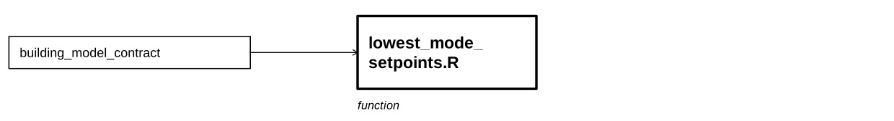

# lowest_mode_setpoints.R

**Function** &nbsp;·&nbsp; `30_Simulation/05_Models/01_Building/03_Functions/lowest_mode_setpoints.R`

## Function

Returns the setpoints of the lowest-numbered mode of 13_Modes_setpoints.csv. They are the setpoints of every row whose action no market has determined: a row takes the lowest-numbered mode until a market sets another one. The low and high setpoints of each system are half a deadband below and above its setpoint, the same rule convert_modes_to_setpoints() applies to every other mode.

## Called by

- [building_model_contract.R](building_model_contract.md)

## What it calls, in order of appearance

- Nothing: this piece calls no other piece of the project.

## Input data

- parameters : Named list. The parameters of the system. A building does not read it: the signature is the one of the operation default_control of the contract of the type of model.
- asset      : Named list. The parameters of the building, its entry of parameters$assets. Must contain:
    - setpoint_modes, the data frame with the columns mode, heating and cooling [degC]
    - control$Deadband, the width of the hysteresis band [degC]

## Output data

- Named list of six numbers [degC]:
    - STP_heat, STP_heat_low, STP_heat_high
    - STP_cool, STP_cool_low, STP_cool_high

## Other notes from the file header

### Code outline

1. Check the inputs
2. Setpoints of the lowest-numbered mode

### Usage instructions

```r
fill <- lowest_mode_setpoints(parameters, asset)
```

## Diagram



Also available as [lowest_mode_setpoints.svg](lowest_mode_setpoints.svg).

---

[Back to the code structure index](../Code_Structure.md)
