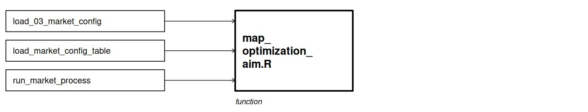

# map_optimization_aim.R

**Function** &nbsp;·&nbsp; `30_Simulation/03_Functions/map_optimization_aim.R`

## Function

Maps raw market aim values to internal optimization aim labels. Accepted input values (case-insensitive):

- O
- E
- O+F
- E+F

Any other value produces an error.

## Called by

- [load_03_market_config.R](load_03_market_config.md)
- [load_market_config_table.R](load_market_config_table.md)
- [run_market_process.R](run_market_process.md)

## What it calls, in order of appearance

- Nothing: this piece calls no other piece of the project.

## Input data

- aim_raw      : Scalar value with market aim code.
- column_name  : Character. Source column name for error messages.
- row_index    : Integer. Current simulation row for error messages.

## Output data

- Character. "energy", "flexibility", "operation" of "operationflex".

## Other notes from the file header

### Usage instructions

```r
map_optimization_aim(aim_raw, column_name, row_index)
```

### Code outline

1. Match the letter against the four aims the model accepts.
2. Stop on anything else, naming the row and the column it came from, because an unknown aim cannot be defaulted.

## Diagram



Also available as [map_optimization_aim.svg](map_optimization_aim.svg).

---

[Back to the code structure index](../Code_Structure.md)
