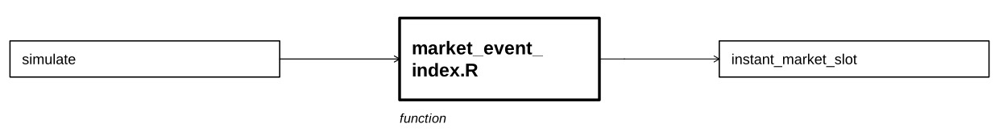

# market_event_index.R

**Function** &nbsp;·&nbsp; `30_Simulation/03_Functions/market_event_index.R`

## Function

Builds the index of market events of one role: one entry per market event, with its own market interval, its name and the period it trades, sorted by market interval. An event's own interval is the one its clearing instant falls in (instant_market_slot()), the key the price matrices of full_market_information are built with.

## Called by

- [simulate.R](simulate.md)

## What it calls, in order of appearance

- [instant_market_slot.R](instant_market_slot.md)

## Input data

- Main_df : Data frame. Must carry the market timeline columns <role>_Market_Name, <role>_Market_Period_Begin and <role>_Market_Period_End, plus time.
- role    : Character scalar, "Sched" or "Pilot". Which of the two market families the index is built for.
- market_resolution : Numeric scalar (min). Length of a market interval, parameters$market$market_resolution.

## Output data

- Data frame with one row per market event of the role, sorted by market_utc, and the columns:
    - market_utc
    - market_num
    - name
    - begins_num
    - ends_num
- The three "_num" columns are seconds since the epoch: the caller compares them against instants inside its own loop, and doing that arithmetic on numbers rather than on POSIXct is what keeps the lookup cheap. market_utc stays POSIXct because it is matched against the time column of the price matrices. Zero rows when the role has no active market at all, which callers treat as "no earlier market" rather than as an error.

## Other notes from the file header

### Why it is a function of its own

The index depends only on Main_df and the role, never on the interval being estimated nor on the price signal being read. It is built once per simulation, for both roles, and every market hands it to price_estimate_sources(), which looks up in it, for every interval beyond the control horizon, the last earlier market that traded that interval.

### Code outline

1. Resolve the role's timeline columns
2. Keep the rows where a market of that role is active
3. One row per market event, sorted

### Usage instructions

```r
events <- market_event_index(Main_df, role, market_resolution)
```

### Exceptions and special cases

- An inactive market is written as 0 in the name column, so the filter tests against "0" and 0 rather than calling is_market_active(): a vectorised test on the raw column is enough, and it scans Main_df once.

## Diagram



Also available as [market_event_index.svg](market_event_index.svg).

---

[Back to the code structure index](../Code_Structure.md)
