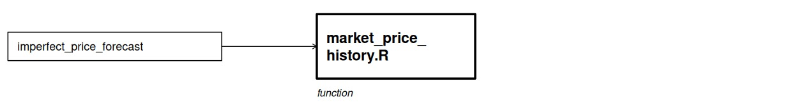

# market_price_history.R

**Function** &nbsp;·&nbsp; `30_Simulation/03_Functions/market_price_history.R`

## Function

Collects the values a price signal took, at the same time of day, in the markets of previous days, so that a forecast can be built from them.

## Called by

- [imperfect_price_forecast.R](imperfect_price_forecast.md)

## What it calls, in order of appearance

- Nothing: this piece calls no other piece of the project.

## Input data

- target_time  : POSIXct scalar. The instant whose price is being forecast.
- market_name  : Character scalar. Name of the market doing the forecasting, as it appears in Main_df's <role>_Market_Name column.
- events       : Data frame. The market event index of the role, as built by market_event_index(): one row per market event, sorted by market_utc, with the columns:
    - market_utc
    - name
    - begins
    - ends It is supplied by the caller rather

than built here because it does not depend on the instant nor on the signal, and this function is called once per instant and once per signal.

- signal_df    : Data frame. One of the matrices of full_market_information, with a time column and one column per step ahead.
- market_time  : POSIXct vector. The full market-resolution grid, used to resolve the step-ahead column of a lookup.
- n_days_back  : Integer scalar. How many previous days to collect.

## Output data

- Numeric vector, of length between 0 and n_days_back. The values found, oldest last. Empty when no previous day yields a value, which happens at the beginning of the series.

## Other notes from the file header

### Why a market and not just a timestamp

A price is not a property of an hour: it is a property of an hour AS PUBLISHED BY A MARKET. The same hour has a different price in the day ahead market and in an intraday market, and that is the whole point of a multi market structure. A forecast of what a given market will pay for a given hour has to be built from what THAT market paid for that same hour on previous days, not from an average of every price that hour ever had.

### The fallback rule

A market does not publish a price for every hour: it publishes for the period it trades. When the market being forecast did not cover the time of day being looked for, the value is taken from the nearest EARLIER market that did cover it. The example in the assignment, which is also one of the test cases: market M25 trades H2 to H4, so it has a price for H3 but not for H1. To forecast H1, M24 is tried next, which trades H2 to H3 and does not cover it either, and then M23, which trades H0 to H3 and does. The value for H1 therefore comes from M23.

### Code outline

1. Nothing to look up when the role has no market at all
2. For each previous day, find the market that covers the instant
3. Read the value from the signal matrix

### Usage instructions

```r
vals <- market_price_history(target_time, market_name, events,
  signal_df, market_time, n_days_back)
```

### Exceptions and special cases

- A day with no market of that role at all contributes nothing, and the returned vector is simply shorter. It is not an error: the first days of a series have no history behind them.
- The fallback walks back over market EVENTS, not over days: it looks for the latest market event of the role whose traded period covers the instant and whose bid time is not later than the one being forecast. If none does, that day contributes nothing.
- The step-ahead column is resolved against market_time, the full market-resolution grid, exactly as the rest of the price lookups do. An instant that falls outside the columns available for that market event contributes nothing.

## Diagram



Also available as [market_price_history.svg](market_price_history.svg).

---

[Back to the code structure index](../Code_Structure.md)
