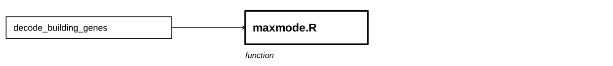

# maxmode.R

**Function** &nbsp;·&nbsp; `30_Simulation/05_Models/01_Building/03_Functions/maxmode.R`

## Function

This function processes an integer mode vector (one mode index per market period) and pairs it with the corresponding timestamps to create a structured data frame.

## Called by

- [decode_building_genes.R](decode_building_genes.md)

## What it calls, in order of appearance

- Nothing: this piece calls no other piece of the project.

## Input data

- x              : Integer vector of length n_periods. Each element is a mode index (integer value from 1 to n_modes) representing the active mode for that market period.
- n_modes        : Integer scalar. Number of available control modes (kept for interface compatibility, not used).
- n_periods      : Integer scalar. Number of market periods in the optimization horizon (kept for interface compatibility, derived from length(x) and length(target_periods)).
- target_periods : POSIXct vector. Market period timestamps used to index the output data frame.

## Output data

- Data frame with two columns: period  – POSIXct. Market period timestamps (equal to target_periods). maxmode – Integer. Mode index for each period (from input vector x).

## Other notes from the file header

### Code outline

1. Create data frame pairing periods with mode indices

### Usage instructions

```r
result <- maxmode(x, n_modes, n_periods, target_periods)
```

### Exceptions and special cases

- n_modes and n_periods are kept as parameters for interface compatibility but are not used in the function body.

## Diagram



Also available as [maxmode.svg](maxmode.svg).

---

[Back to the code structure index](../Code_Structure.md)
