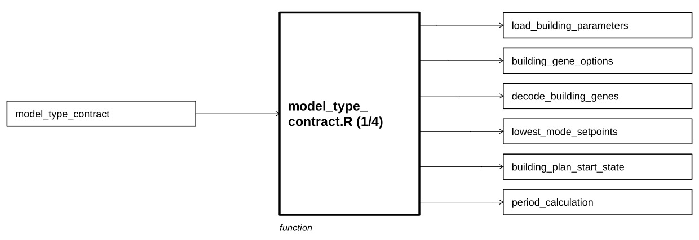

# model_type_contract.R &mdash; Called items, block 1 of 4

Block 1 of 4 of [model_type_contract.R](model_type_contract.md).

## What it calls, in this block

- [load_building_parameters.R](load_building_parameters.md)
- [building_gene_options.R](building_gene_options.md)
- [decode_building_genes.R](decode_building_genes.md)
- [lowest_mode_setpoints.R](lowest_mode_setpoints.md)
- [building_plan_start_state.R](building_plan_start_state.md)
- [period_calculation.R](period_calculation.md)

## Diagram

Also available as [model_type_contract__1.svg](model_type_contract__1.svg).

---

[Back to model_type_contract.R](model_type_contract.md) &nbsp;·&nbsp; [Back to the code structure index](../Code_Structure.md)
