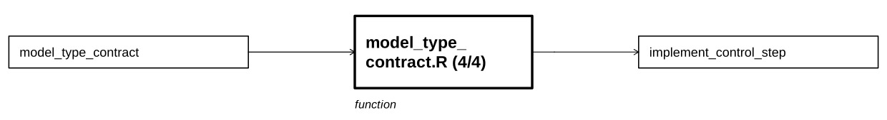

# model_type_contract.R &mdash; Called items, block 4 of 4

Block 4 of 4 of [model_type_contract.R](model_type_contract.md).

## What it calls, in this block

- [implement_control_step.R](implement_control_step.md)

## Diagram

Also available as [model_type_contract__4.svg](model_type_contract__4.svg).

---

[Back to model_type_contract.R](model_type_contract.md) &nbsp;·&nbsp; [Back to the code structure index](../Code_Structure.md)
