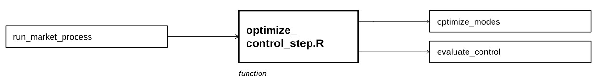

# optimize_control_step.R

**Function** &nbsp;·&nbsp; `30_Simulation/03_Functions/optimize_control_step.R`

## Function

This function performs the optimization of the control strategy for a single MPC step: it searches the best control of each asset for each market period (for a building, its control mode), and then computes the forecasted building states resulting from the optimized setpoints. It performs the following steps:

1. Calls optimize_modes() to find the optimal control schedule (it already returns the control of each asset; for a building, its setpoints with hysteresis deadbands, built internally via convert_modes_to_setpoints()). When no asset has genes, optimize_modes() returns an empty list, and the plan of every asset is evaluated as it is.
2. Calls evaluate_control() with the optimized controls to compute the expected building states under forecasted weather (period_calculation() internally reads Text_forec/SolarR_forec instead of Text/SolarR for the "plan"/"plan_flex_down" calculation contexts; the Text and SolarR columns are not overwritten).

## Called by

- [run_market_process.R](run_market_process.md)

## What it calls, in order of appearance

- [optimize_modes.R](optimize_modes.md)
- [evaluate_control.R](evaluate_control.md)

## Input data

- piece                    : List. The piece of the optimization horizon, as build_market_piece() gives it: the table of the system and the table of each asset. Together the tables hold 'Text_forec', 'SolarR_forec', 'Text', 'SolarR', and all columns required by period_calculation().
- timestamps               : Named list. Timestamp metadata, passed through to optimize_modes() and to evaluate_control(). Must contain timestamps$target_periods (POSIXct vector of market period timestamps for the optimization horizon).
- parameters               : List. Model parameters passed to optimize_modes() and evaluate_control(). The following sub-elements are extracted internally: parameters$optimization parameters$assets, the asset registry; the building holds the setpoint_modes and its control$Deadband
- simulation_control        : Named list. Index/step metadata, passed through to optimize_modes() and evaluate_control() for interface consistency.
- marginal_context          : Named list or NULL (default NULL). Passed through to optimize_modes() and to the final evaluate_control() call.
- worker_cluster            : Cluster of worker processes of the simulation (start_worker_cluster()) when parallel = 1, NULL otherwise. Passed through to optimize_modes().

## Output data

- A named list with two elements: controls : Named list. The optimized control of each asset, named by its asset_id, as returned by optimize_modes(): for the building, the setpoint schedule with hysteresis deadbands for the target periods. piece    : List. The piece with the expected states of each asset under the optimized setpoints and forecasted weather, corresponding to the best flexibility scenario found (the piece from evaluate_control()):
    - the plan of each asset in its table: all the columns returned by period_calculation() plus the *_plan columns (for a building: Ti_plan, Te_plan, the STP_*_plan setpoints, Act_*_plan, Q_*_plan, Elec_*_plan and Elec_total_plan);
    - in the table of the system, the net electricity of the plan and the flexibility itineraries of the best scenario (Q=0 over the optimal window), with their phases, the held legs of the standing commitment and the per-row Reward.

## Other notes from the file header

### Code outline

1. Search the control modes with optimize_modes()
2. Run evaluate_control() with the optimized setpoints and forecasted weather to compute expected building states
3. Return the optimized controls and the piece

### Usage instructions

```r
result <- optimize_control_step(piece, timestamps, parameters,
  simulation_control, marginal_context,
  worker_cluster)
```

### Exceptions and special cases

- The worker cluster is created once for the whole simulation by start_worker_cluster(), called from simulate(), and stopped there when the loop ends. optimize_modes() only uses it.

## Diagram



Also available as [optimize_control_step.svg](optimize_control_step.svg).

---

[Back to the code structure index](../Code_Structure.md)
