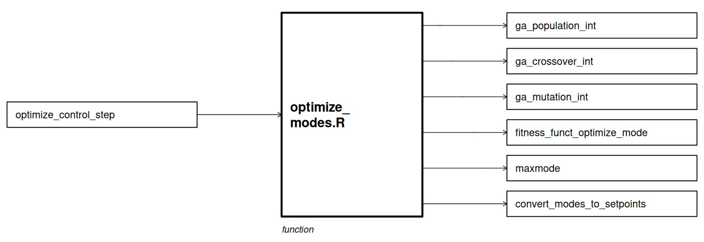

# optimize_modes.R

**Function** &nbsp;·&nbsp; `30_Simulation/03_Functions/optimize_modes.R`

## Function

This function optimizes the control modes over a particular period using a Genetic Algorithm (GA) approach with real-type genes that are constrained to integer values through custom population, crossover, and mutation operators. It performs the following steps:

1. Defines the optimization vector based on the number of modes and the number of market periods in the target period. It also sizes the elitism against the number of distinct chromosomes the space holds, because ga()'s own default can exceed it and inject an NA row into the population.
2. Initializes parallelization to speed up the optimization process.
3. Calls the GA optimizer with custom integer-handling operators to find the optimal control mode sequence that maximizes the reward function.
4. Post-processes the optimization results to extract the optimal control modes for each market period.

## Called by

- [optimize_control_step.R](optimize_control_step.md)

## What it calls, in order of appearance

- [ga_population_int.R](ga_population_int.md)
- [ga_crossover_int.R](ga_crossover_int.md)
- [ga_mutation_int.R](ga_mutation_int.md)
- [fitness_funct_optimize_mode.R](fitness_funct_optimize_mode.md)
- [maxmode.R](maxmode.md)
- [convert_modes_to_setpoints.R](convert_modes_to_setpoints.md)

## Input data

- period_chunk   : Data frame. Simulation data for the optimization horizon. Must contain a 'MarketUTC' column used to derive the set of target periods, plus all columns required by period_calculation() (called inside evaluate_control()).
- timestamps     : Named list. Timestamp metadata. Must contain: timestamps$target_periods : POSIXct vector of market period timestamps.
- parameters     : Named list. Model parameters passed through to period_calculation() and reward_function(). The following sub-elements are extracted internally: parameters$setpoint_modes parameters$control$Deadband parameters$optimization, as returned by load_optimization_parameters():
    - population_size
    - iteration_number
    - run_number
    - pcrossover
    - pmutation
    - parallel
- simulation_control : Named list. Index/step metadata (passed through for interface consistency).
- marginal_context : Named list or NULL. Passed through to the fitness function and, via clusterExport(), to worker processes.

## Output data

- set_point_optimized : Data frame with setpoint columns and hysteresis deadbands for the optimal control modes, as returned by convert_modes_to_setpoints().

## Other notes from the file header

### Code outline

1. Define GA chromosome structure for mode selection (integer vector)

1b. Size the elitism against the search space

2. Configure genetic algorithm parameters with custom operators
3. Initialize parallelization
4. Run GA optimization with mode fitness function
5. Stop cluster (if parallel)
6. Post-process: extract best mode solution and convert to setpoints

### Usage instructions

```r
result <- optimize_modes(period_chunk, timestamps, parameters, simulation_control)
```

### Exceptions and special cases

- Parallelization uses parallel_workers worker processes, or all logical cores but one when it is 0. The cluster is stopped and sequential execution restored after the GA run.
- Worker processes (PSOCK clusters) do not inherit the global environment: every function it holds is exported to them, and the data of this optimization by name, via clusterExport().
- The GA uses real-type encoding with custom integer operators: n_periods genes, each representing a mode index (1 to n_modes).
- The custom operators read the selected parent chromosomes from the current GA population to keep the representation valid from the start.
- Only the first solution row of the GA result (ga_result@solution[1,]) is used if multiple equally-fit solutions exist.

## Diagram



Also available as [optimize_modes.svg](optimize_modes.svg).

---

[Back to the code structure index](../Code_Structure.md)
