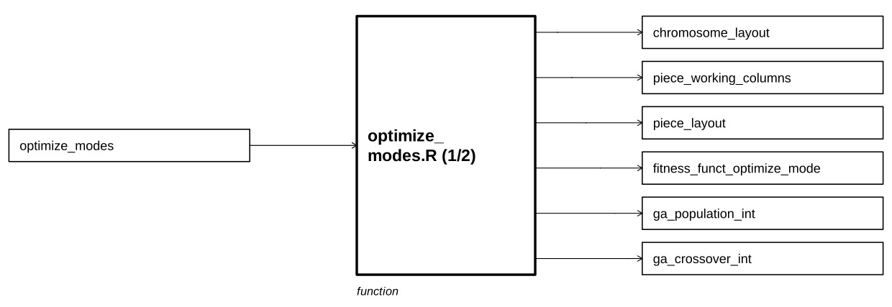

# optimize_modes.R &mdash; Called items, block 1 of 2

Block 1 of 2 of [optimize_modes.R](optimize_modes.md).

## What it calls, in this block

- [chromosome_layout.R](chromosome_layout.md)
- [piece_working_columns.R](piece_working_columns.md)
- [piece_layout.R](piece_layout.md)
- [fitness_funct_optimize_mode.R](fitness_funct_optimize_mode.md)
- [ga_population_int.R](ga_population_int.md)
- [ga_crossover_int.R](ga_crossover_int.md)

## Diagram

Also available as [optimize_modes__1.svg](optimize_modes__1.svg).

---

[Back to optimize_modes.R](optimize_modes.md) &nbsp;·&nbsp; [Back to the code structure index](../Code_Structure.md)
