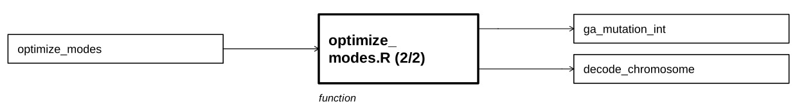

# optimize_modes.R &mdash; Called items, block 2 of 2

Block 2 of 2 of [optimize_modes.R](optimize_modes.md).

## What it calls, in this block

- [ga_mutation_int.R](ga_mutation_int.md)
- [decode_chromosome.R](decode_chromosome.md)

## Diagram

Also available as [optimize_modes__2.svg](optimize_modes__2.svg).

---

[Back to optimize_modes.R](optimize_modes.md) &nbsp;·&nbsp; [Back to the code structure index](../Code_Structure.md)
