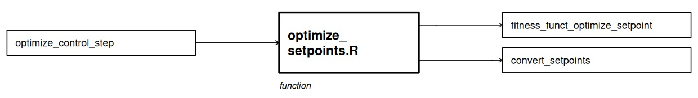

# optimize_setpoints.R

**Function** &nbsp;·&nbsp; `30_Simulation/03_Functions/optimize_setpoints.R`

## Function

This function optimizes heating and cooling setpoints over a particular period using a Genetic Algorithm (GA) approach. It performs the following steps:

1. Defines the optimization vectors based on the number of market slots in the target period.
2. Initializes parallelization to speed up the optimization process.
3. Calls the GA optimizer to find the optimal setpoint sequence that maximizes the reward function.
4. Post-processes the optimization results to extract the optimal heating and cooling setpoints for each market period.

## Called by

- [optimize_control_step.R](optimize_control_step.md)

## What it calls, in order of appearance

- [fitness_funct_optimize_setpoint.R](fitness_funct_optimize_setpoint.md)
- [convert_setpoints.R](convert_setpoints.md)

## Input data

- period_chunk   : Data frame. Simulation data for the optimization horizon. Must contain a 'MarketUTC' column used to determine the number of market periods (horizon), plus all columns required by period_calculation() (called inside evaluate_control()).
- timestamps     : Named list. Timestamp metadata. Must contain: timestamps$target_periods : POSIXct vector of market period timestamps.
- parameters     : Named list. Model parameters passed through to period_calculation() and reward_function(). The following sub-elements are extracted internally: parameters$control$set_point_range_heating parameters$control$set_point_range_cooling parameters$control$Deadband parameters$optimization, as returned by load_optimization_parameters():
    - population_size
    - iteration_number
    - run_number
    - pcrossover
    - pmutation
    - parallel
- simulation_control : Named list. Index/step metadata (passed through to the fitness function for interface consistency).
- marginal_context : Named list or NULL. Passed through to the fitness function and, via clusterExport(), to worker processes.

## Output data

- set_point_optimized : Data frame with setpoint columns and hysteresis deadbands for the optimal heating and cooling setpoints, as returned by convert_setpoints().

## Other notes from the file header

### Code outline

1. Build lower and upper bounds for heating/cooling setpoints
2. Configure genetic algorithm (GA) parameters
3. Run GA optimization with fitness function
4. Extract best setpoint solution
5. Convert best solution to a set_point_df with hysteresis deadbands via convert_setpoints()

### Usage instructions

```r
result <- optimize_setpoints(period_chunk, timestamps, parameters, simulation_control)
```

### Exceptions and special cases

- Parallelization uses parallel_workers worker processes, or all logical cores but one when it is 0. The cluster is stopped and sequential execution restored after the GA run.
- Worker processes (PSOCK clusters) do not inherit the global environment: every function it holds is exported to them, and the data of this optimization by name, via clusterExport().
- The GA uses real-valued encoding: 2 * horizon real genes, where the first 'horizon' genes are heating setpoints and the next 'horizon' genes are cooling setpoints.
- The GA optimization vector has lower bounds set to set_point_range_heating[1] and set_point_range_cooling[1], and upper bounds to set_point_range_heating[2] and set_point_range_cooling[2].
- Only the first solution row of the GA result (ga_result@solution[1,]) is used if multiple equally-fit solutions exist.

## Diagram



Also available as [optimize_setpoints.svg](optimize_setpoints.svg).

---

[Back to the code structure index](../Code_Structure.md)
