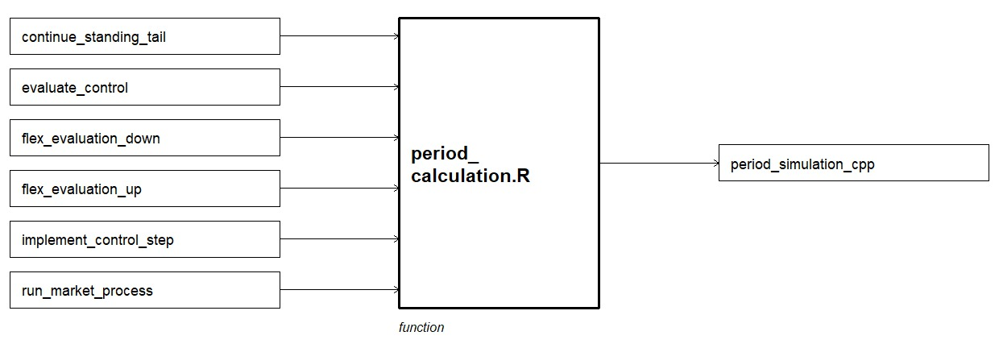

# period_calculation.R

**Function** &nbsp;·&nbsp; `30_Simulation/03_Functions/period_calculation.R`

## Function

This function performs the physical simulation of the building for a given period based on climate data and setpoint values. This function:

- runs over a dataframe
- defines control signals for each timestep and
- activates heating and cooling systems accordingly
- computes changes to the building thermal state
- calculates comfort level

This function performs no economic calculation (see EXCEPTIONS below): Elec_Cost is resolved elsewhere, through reward_function() for "plan"/ "plan_flex_down" and through calc_differential_cost() for "execution". A 2C simplified model is used, with a pseudo-static approach. Histeresis-based thermostatic control is used for heating and cooling systems. Schedule-based ventilation is performed. Details of all this can be found in the readme file.

This function takes and returns dataframes, but uses vectors internally for faster computation.

## Called by

- [continue_standing_tail.R](continue_standing_tail.md)
- [evaluate_control.R](evaluate_control.md)
- [flex_evaluation_down.R](flex_evaluation_down.md)
- [flex_evaluation_up.R](flex_evaluation_up.md)
- [implement_control_step.R](implement_control_step.md)
- [run_market_process.R](run_market_process.md)

## What it calls, in order of appearance

- [period_simulation_cpp.cpp](period_simulation_cpp.md)

## Input data

- period_chunk     : Data frame. Time series data for the simulation period. Must contain the following columns: time        - POSIXct. Simulation timestamps. SolarR      - Numeric. Solar radiation (W/m²). Text        - Numeric. External air temperature (°C). T_ext_24h   - Numeric. 24-hour running mean of external temperature (°C). Occupancy   - Integer (0/1). Building occupancy flag. The C++ core runs daytime ventilation while it is 1. MarketUTC   - POSIXct. Market period timestamps for setpoint lookup. Ti          - Numeric. Initial internal temperature (°C) at row 1. (Prefix applies based on context) Te          - Numeric. Initial envelope temperature (°C) at row 1. (Prefix applies based on context) Act_heat    - Integer (0/1). Initial heating activation at row 1. (Prefix applies based on context) Act_cool    - Integer (0/1). Initial cooling activation at row 1. (Prefix applies based on context) Service_T_Low and Service_T_High - Numeric. Comfort band, required when calculation_context is "execution". Scheduling_T_Low and Scheduling_T_High - Numeric. Comfort band, required when calculation_context is "plan", "plan_flex_down" or "plan_flex_up". For "plan_flex_down" and "plan_flex_up", also Service_T_Low, Service_T_High and the phase column of the leg (Flex_phase_down_plan or Flex_phase_up_plan): on the rows of a flexibility window (phase above 0) the occupancy band Service_T_* is used instead of Scheduling_T_*. If set_point_df is NULL, must ALSO contain (with context suffix):
    - STP_heat_low
    - STP_heat_high
    - STP_cool_low
    - STP_cool_high

Optional columns (carried over from period_chunk if present, NA treated as 0, initialized to 0 if absent):

- Q_heat
- Q_cool
- Elec_heat
- Elec_cool
- Elec_total
- Comfort
- set_point_df     : Optional Data frame (Default: NULL). Setpoint schedule with columns: period        - POSIXct. Market period timestamps. STP_heat      - Numeric. Heating setpoint (°C). STP_heat_low  - Numeric. Lower heating threshold (°C). STP_heat_high - Numeric. Upper heating threshold (°C). STP_cool      - Numeric. Cooling setpoint (°C). STP_cool_low  - Numeric. Lower cooling threshold (°C). STP_cool_high - Numeric. Upper cooling threshold (°C). If provided, overwrites corresponding context-suffixed values in period_chunk.
- parameters       : List. Model parameters. Must include sub-list: parameters$model - thermal model coefficients, among them:
    - Ci
    - Ce
    - Rie
    - Rea
    - Aw
    - Ae
    - the heat pump coefficients
    - Rvent01
    - Rvent1
    - Rvent2
    - Rvent2_HR
    - Setpoint_Rvent1
    - inertial_fact

(Comfort thresholds are read from period_chunk, not from parameters$reward - see period_chunk columns above.)

- calculation_mode : Integer scalar or vector. Computation mode per timestep: 1 - Setpoint mode: Q_heat and Q_cool are computed from histeresis control logic. 2 - Heat Input mode: Q_heat and Q_cool are read directly from period_chunk columns. 3 - Setpoint with a per-step power cap: as mode 1, but the decision of every step is bounded by Q_heat_cap/Q_cool_cap before the RC equations, so the bound propagates to the next step's state. If a scalar is provided, it is expanded to all timesteps. Default: 1.
- Q_heat_cap       : Numeric vector or NULL. Per-step upper bound on the heating energy of the timesteps in mode 3 (kWh per step, the same unit as the Q_heat columns). Must have one value per row of period_chunk. NULL (the default) means no bound anywhere, which leaves mode 3 identical to mode 1. Ignored by the timesteps in modes 1 and 2.
- Q_cool_cap       : Numeric vector or NULL. Same as Q_heat_cap, for cooling.
- calculation_context: Character. Determines the dataframe columns to read from/write to. Valid options: "execution" (default), "plan", "plan_flex_down", "plan_flex_up". "execution" reads/writes with "_exec" suffix (e.g. Ti_exec, Q_heat_exec, STP_heat_low_exec). "plan" reads/writes with "_plan" suffix (e.g. Ti_plan, STP_heat_low_plan). "plan_flex_down" reads/writes with "_plan_flex_down" suffix (downward flexibility itinerary). "plan_flex_up" reads/writes with "_plan_flex_up" suffix (upward flexibility itinerary).

## Output data

- period_chunk : Data frame. The input data frame with the following columns added or updated (depending on calculation_context): Ti         - Numeric. Internal temperature time series (°C). Te         - Numeric. Envelope temperature time series (°C). Q_heat     - Numeric. Heating energy per timestep (kWh or equivalent). Q_cool     - Numeric. Cooling energy per timestep. Elec_heat  - Numeric. Heating electricity consumption per timestep. Elec_cool  - Numeric. Cooling electricity consumption per timestep. Elec_total - Numeric. Total electricity consumption per timestep. Comfort    - Integer (0/1). Comfort flag per timestep. Act_heat   - Integer (0/1). Heating activation per timestep. Act_cool   - Integer (0/1). Cooling activation per timestep.

## Other notes from the file header

### Code outline

1. Validate inputs and calculation context
2. Extract model parameters
3. Create internal vectors for fast computation
4. Apply setpoints from set_point_df if provided (vectorized by MarketUTC)
5. Validate initial states and setpoint vectors
6. Simulation loop: hysteresis control, thermal dynamics, energy
7. Write results back to data frame

### Usage instructions

```r
result_df <- period_calculation(period_chunk, parameters)
```

```r
result_df <- period_calculation(period_chunk, parameters, calculation_mode = 2, calculation_context = "plan", set_point_df = sp_df)
```

### Exceptions and special cases

- If period_chunk has fewer than 2 rows, the function returns the input data frame unchanged (no simulation is performed).
- If set_point_df is NULL and suffixed setpoint columns are missing in period_chunk, an error is raised via stop().
- calculation_mode can be a per-timestep vector; invalid values (not 1, 2 or 3) raise an error via stop(). A length mismatch with the number of timesteps also raises an error.
- Q_heat_cap/Q_cool_cap are accepted whatever the modes in use, and are only read by the timesteps in mode 3. A non-NULL cap whose length does not match the number of timesteps raises an error via stop(); NA values inside a cap vector are treated as "no bound", the same as Inf.
- The system lock these caps implement is an interpretation of the legal regulation of HVAC systems, which does not allow energy management through the alternating use of heating and cooling. See build_system_lock_caps.R.
- Invalid calculation_context value will raise an error via stop().
- If a MarketUTC value in period_chunk has no matching 'period' entry in set_point_df, the function raises an error via stop().
- If set_point_df$period contains duplicated values, the function raises an error via stop() before applying setpoints.
- Heating and cooling are mutually exclusive: if heating is active, cooling is forced off regardless of the temperature relative to the cooling setpoint.
- Setpoints are applied using hysteresis: heating activates when Ti drops below STP_heat_low and deactivates when Ti rises above STP_heat_high; cooling applies the same logic with STP_cool_low and STP_cool_high.
- The optional columns listed under Inputs are carried over from period_chunk's existing value at row 1 (the initial-condition row, never recomputed by the simulation loop) whenever the column is already present, and initialized to 0 if absent from period_chunk; NA values in these columns are also treated as 0.
- If required initial states or setpoint values are missing, the function stops with an error so the simulation does not continue with undefined control logic.
- inertial_fact is read from parameters$model and used in the internal temperature calculation when the thermal inertia distribution model is active.

## Diagram



Also available as [period_calculation.svg](period_calculation.svg).

---

[Back to the code structure index](../Code_Structure.md)
