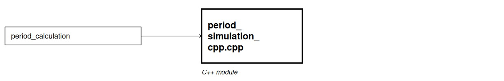

# period_simulation_cpp.cpp

**C++ module** &nbsp;·&nbsp; `30_Simulation/03_1_Functions_Cpp/period_simulation_cpp.cpp`

## Function

No description block in the file header.

## Called by

- [period_calculation.R](period_calculation.md)

## What it calls, in order of appearance

- Nothing: this piece calls no other piece of the project.

## Diagram

Also available as [period_simulation_cpp.svg](period_simulation_cpp.svg).

---

[Back to the code structure index](../Code_Structure.md)
