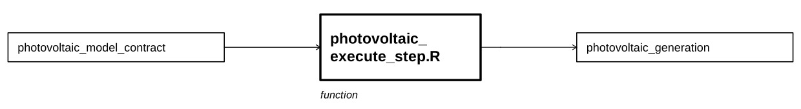

# photovoltaic_execute_step.R

**Function** &nbsp;·&nbsp; `30_Simulation/05_Models/02_Photovoltaic/03_Functions/photovoltaic_execute_step.R`

## Function

Runs a photovoltaic installation over a step of the simulation. It is the operation execute_step of the contract of the type Photovoltaic (see model_type_contract()). The installation holds no control, so the step is its production over the rows of the chunk, computed with the weather of the calculation context: the measured weather for "execution", and the forecast for "plan". It is the asset side of the step, like the one of any other type: it writes no money and no column of the system.

## Called by

- [photovoltaic_model_contract.R](photovoltaic_model_contract.md)

## What it calls, in order of appearance

- [photovoltaic_generation.R](photovoltaic_generation.md)

## Input data

- period_chunk        : Data frame. The rows of the step, with time, the weather and the columns Elec_PV and Elec_total of the context.
- simulation_control  : Named list. Not read.
- timestamps          : Named list. Not read.
- parameters          : Named list. Not read.
- asset               : Named list. The parameters of the installation, its entry of parameters$assets.
- calculation_context : Character. "execution" or "plan".
- Every operation execute_step of the contract receives the same arguments (see model_type_contract()).

## Output data

- Data frame. period_chunk with the production of the step written.

## Other notes from the file header

### Code outline

1. Compute the production of the step

### Usage instructions

```r
period_chunk <- photovoltaic_execute_step(
  period_chunk        = period_chunk,
  simulation_control  = simulation_control,
  timestamps          = timestamps,
  parameters          = parameters,
  asset               = asset,
  calculation_context = "execution"
  )
```

## Diagram



Also available as [photovoltaic_execute_step.svg](photovoltaic_execute_step.svg).

---

[Back to the code structure index](../Code_Structure.md)
