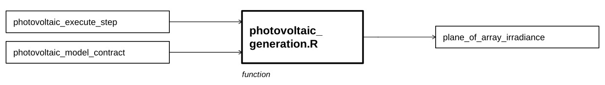

# photovoltaic_generation.R

**Function** &nbsp;·&nbsp; `30_Simulation/05_Models/02_Photovoltaic/03_Functions/photovoltaic_generation.R`

## Function

Computes the electricity a photovoltaic installation produces over a chunk, for one itinerary, with the radiation on the plane of its modules. It is the operation simulate_itinerary of the contract of the type Photovoltaic (see model_type_contract()). The installation has no control: its production depends only on the solar radiation and the outdoor temperature, so the plan and the two flexibility itineraries get the same production when they are computed with the same weather. The weather is the one of the calculation context:

- execution: the measured weather, SolarR and Text.
- plan, plan_flex_down and plan_flex_up: the forecast of the weather, SolarR_forec and Text_forec.

Row 1 of the chunk is the initial condition and it is never written. Each row i >= 2 holds the energy of the step that ends in it, with the weather of the row and the duration of the step, delta_t_h = (time[i] - time[i - 1]) / 3600.

## Called by

- [photovoltaic_execute_step.R](photovoltaic_execute_step.md)
- [photovoltaic_model_contract.R](photovoltaic_model_contract.md)

## What it calls, in order of appearance

- [plane_of_array_irradiance.R](plane_of_array_irradiance.md)

## Input data

- period_chunk        : Data frame. The chunk, with time, the weather of the context, the columns Sun_elevation and Cos_incidence, and the columns G_poa, T_cell, Elec_PV and Elec_total of the context.
- asset               : Named list. The parameters of the installation, its entry of parameters$assets, with the groups photovoltaic, reference_conditions and sun.
- calculation_mode    : Not read.
- calculation_context : Character. One of "execution", "plan", "plan_flex_down" and "plan_flex_up".
- set_point_df        : Not read.
- Q_heat_cap          : Not read.
- Q_cool_cap          : Not read.
- Every operation simulate_itinerary of the contract receives the same arguments (see model_type_contract()). An installation has no setpoints and no heat or cooling power, so it does not read the last four.

## Output data

- Data frame. period_chunk with G_poa, T_cell, Elec_PV and Elec_total of the context written on rows 2 to n. A chunk of fewer than 2 rows comes back as it was. The run stops if the weather or the geometry of the sun of a row it writes is missing.

## Other notes from the file header

### The model

In each step, with G the solar radiation on the horizontal plane (W/m2) and T_amb the outdoor temperature (degC), and the reference conditions of the modules (reference_conditions of asset):

1. G_poa  <- the radiation on the plane of the modules (W/m2), from G and from the geometry of the sun of the row (see plane_of_array_irradiance()). A negative radiation, which a forecast may give, counts as 0.
2. T_cell <- T_amb + (NOCT - PV_NOCT_ambient_temperature) * G_poa / PV_NOCT_irradiance The temperature of the cells.
3. P_dc   <- Module_area * Module_efficiency * G_poa / 1000 * (1 - DC_losses) * (1 + Temperature_coefficient / 100 * (T_cell - PV_STC_cell_temperature)) The power of the modules (kW). The 1000 turns W into kW and the 100 turns the coefficient from %/K to 1/K. DC_losses holds the losses of the wiring, the dirt, the mismatch, the first degradation and the tolerance of the modules, and not those of the temperature, which this step computes.
4. P_ac   <- pmin(Inverter_efficiency * pmax(P_dc, 0), Inverter_power) The power the inverter delivers (kW): never negative, with the losses of the inverter, and clipped at its maximum power.
5. Elec_PV <- P_ac * delta_t_h; Elec_total <- -Elec_PV The energy of the step (kWh). The production is negative electricity for the system.

The elevation of the sun and the cosine of the angle of incidence of the row come from the table of the installation (see photovoltaic_solar_geometry()).

### Code outline

1. Check the context and take the weather
2. Compute the production
3. Write it into the chunk

### Usage instructions

```r
period_chunk <- photovoltaic_generation(
  period_chunk        = period_chunk,
  asset               = asset,
  calculation_context = "plan"
  )
```

## Diagram



Also available as [photovoltaic_generation.svg](photovoltaic_generation.svg).

---

[Back to the code structure index](../Code_Structure.md)
