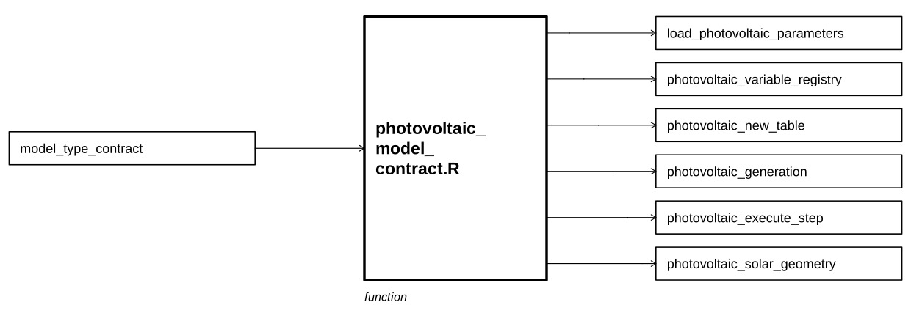

# photovoltaic_model_contract.R

**Function** &nbsp;·&nbsp; `30_Simulation/05_Models/02_Photovoltaic/03_Functions/photovoltaic_model_contract.R`

## Function

Gives the contract of the type of model Photovoltaic: the table of the functions through which the rest of the simulator operates a photovoltaic installation. It is the table that model_type_contract() returns for an asset whose asset_type is Photovoltaic. The operations, with their arguments and their results, are described in model_type_contract(). A photovoltaic installation has no control. It produces electricity from the solar radiation and the outdoor temperature, and nothing the system decides changes what it produces. It has no genes, no setpoints, no comfort and no state to carry, and it cannot move its electricity in time. Its operations are written for that:

- Those that carry out something are bound to functions of this folder, 30_Simulation/05_Models/02_Photovoltaic/03_Functions/: load_parameters, variable_registry, new_table, simulate_itinerary and execute_step.
- The others are written below, in the table, because each one is a line: they return what they receive, or an answer that says the installation has nothing to do there.
- decode_genes, margin_fit and margin_energy work on genes and on the margin data of a window, which an installation never holds. They stop with a message if they are called.

## Called by

- [model_type_contract.R](model_type_contract.md)

## What it calls, in order of appearance

- [load_photovoltaic_parameters.R](load_photovoltaic_parameters.md)
- [photovoltaic_variable_registry.R](photovoltaic_variable_registry.md)
- [photovoltaic_new_table.R](photovoltaic_new_table.md)
- [photovoltaic_generation.R](photovoltaic_generation.md)
- [photovoltaic_execute_step.R](photovoltaic_execute_step.md)
- [photovoltaic_solar_geometry.R](photovoltaic_solar_geometry.md)

## Input data

- None.

## Output data

- Named list of functions, one per operation above.

## Other notes from the file header

### The operations

For a photovoltaic installation:

- load_parameters: its parameter group, read from its file, the reference conditions of the modules and the solar constant.
- variable_registry: the path of its variable registry, which declares the columns of its table.
- new_table: its table on the time grid, with the columns of its variable registry.
- prepare_year: the geometry of the sun (its elevation and azimuth and the incidence of its rays on the modules), written in the table for the whole year.
- initial_state, prepare_period: it has nothing to prepare and no initial condition to write: they return the table as it comes.
- gene_options: 0, it has no genes.
- decode_genes: it stops, it has no genes to decode.
- default_control: an empty list, it has no control.
- can_hold: FALSE. Its equipment cannot keep its electricity apart from its production.
- plan_start_state: it carries no state, and the chunk comes back as it comes.
- simulate_itinerary: its production over a chunk, with the weather of the context.
- comfort: 0 on every row.
- window_feasible: TRUE, it holds no energy of a window that could break a technical rule.
- slot_offer: FALSE, it has nothing to offer on a new window.
- window_draft: it draws nothing, and has no margin data.
- margin_fit, margin_energy: they stop, it has no margin data.
- window_contribution: the chunk as it comes, with nothing drawn and no refusal.
- restate_systems: NULL, it has no alternatives to redraw with.
- hold_room: 0 on every row, it can hold nothing.
- window_hold, continue_window_tail: the chunk as it comes.
- tail_state: no state and no system.
- execute_step: its production over a step of the simulation.
- reads_rest_net: FALSE, its production does not depend on the rest of the system.
- stored_energy_change: NULL, it stores no energy.
- recovery_choices: NULL, it has no Recovery Phase to draw.

### Auxiliary functions

The operations that are a line are written as auxiliary functions of photovoltaic_model_contract(), in this file, after it. They are named functions, defined once when the file is sourced, so that the contract hands over the same functions on every call instead of creating them again. The file holds:

- photovoltaic_model_contract() (main function)
- photovoltaic_prepare_year()
- photovoltaic_initial_state()
- photovoltaic_prepare_period()
- photovoltaic_gene_options()
- photovoltaic_decode_genes()
- photovoltaic_default_control()
- photovoltaic_can_hold()
- photovoltaic_plan_start_state()
- photovoltaic_comfort()
- photovoltaic_window_feasible()
- photovoltaic_slot_offer()
- photovoltaic_window_draft()
- photovoltaic_margin_fit()
- photovoltaic_margin_energy()
- photovoltaic_window_contribution()
- photovoltaic_restate_systems()
- photovoltaic_hold_room()
- photovoltaic_window_hold()
- photovoltaic_continue_window_tail()
- photovoltaic_tail_state()
- photovoltaic_reads_rest_net()
- photovoltaic_stored_energy_change()
- photovoltaic_recovery_choices()

### Code outline

1. Bind each operation to its function

### Usage instructions

```r
contract <- photovoltaic_model_contract()
```

contract$simulate_itinerary(

- period_chunk        = period_chunk,
- asset               = asset,
- calculation_mode    = 1,
- calculation_context = "plan"

)

## Diagram



Also available as [photovoltaic_model_contract.svg](photovoltaic_model_contract.svg).

---

[Back to the code structure index](../Code_Structure.md)
