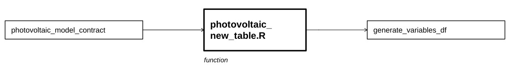

# photovoltaic_new_table.R

**Function** &nbsp;·&nbsp; `30_Simulation/05_Models/02_Photovoltaic/03_Functions/photovoltaic_new_table.R`

## Function

Builds the table of a photovoltaic installation on a time grid, with every column of its variable registry at its initial value. It is the operation new_table of the contract of the type Photovoltaic (see model_type_contract()). The table holds the electricity the installation produces and its electricity for the system, each one for the execution and for the plan and the two flexibility itineraries.

## Called by

- [photovoltaic_model_contract.R](photovoltaic_model_contract.md)

## What it calls, in order of appearance

- [generate_variables_df.R](generate_variables_df.md)

## Input data

- time  : POSIXct vector. The time grid of the simulation, that of Main_df.
- paths : List. The paths of the simulator. The variable registry of the installation is the file paths$photovoltaic_variables_file.

## Output data

- Data frame. The table of the installation, one row per element of time.

## Other notes from the file header

### Code outline

1. Synthesize the table from the variable registry

### Usage instructions

```r
asset_df <- photovoltaic_new_table(
  time  = Main_df$time,
  paths = paths
  )
```

## Diagram



Also available as [photovoltaic_new_table.svg](photovoltaic_new_table.svg).

---

[Back to the code structure index](../Code_Structure.md)
