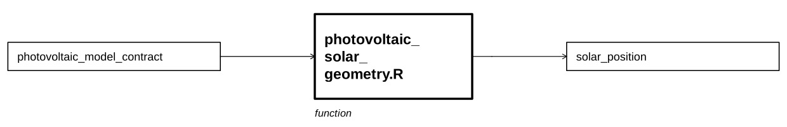

# photovoltaic_solar_geometry.R

**Function** &nbsp;·&nbsp; `30_Simulation/05_Models/02_Photovoltaic/03_Functions/photovoltaic_solar_geometry.R`

## Function

Writes the geometry of the sun in the table of a photovoltaic installation: the elevation and the azimuth of the sun and the cosine of the angle of incidence of its rays on the modules, for every row of the table. It is the operation prepare_year of the contract of the type Photovoltaic (see model_type_contract()), whose contract entry takes Main_df too and does not pass it on. The geometry only depends on the instant of each row and on the location and the orientation of the installation, so it is computed once for the whole year, before the period is cut, and the model reads it from the table in every step.

## Called by

- [photovoltaic_model_contract.R](photovoltaic_model_contract.md)

## What it calls, in order of appearance

- [solar_position.R](solar_position.md)

## Input data

- asset_df : Data frame. The table of the installation, with its time column.
- asset    : Named list. The parameters of the installation, its entry of parameters$assets. This function reads its group photovoltaic:
    - Latitude
    - Longitude
    - Irradiance_time_offset
    - Tilt
    - Azimuth

## Output data

- Data frame. asset_df with the columns Sun_elevation (deg), Sun_azimuth (deg) and Cos_incidence (-) added.

## Other notes from the file header

### Code outline

1. Compute the geometry of the sun
2. Write it into the table

### Usage instructions

```r
asset_df <- photovoltaic_solar_geometry(
  asset_df = asset_df,
  asset    = asset
  )
```

## Diagram



Also available as [photovoltaic_solar_geometry.svg](photovoltaic_solar_geometry.svg).

---

[Back to the code structure index](../Code_Structure.md)
