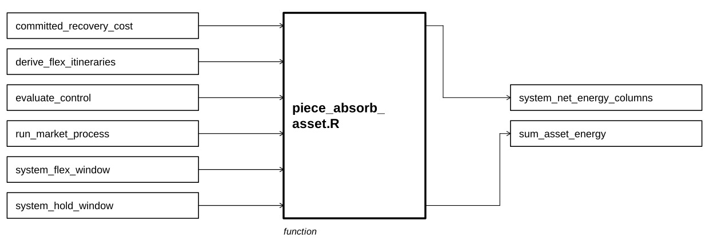

# piece_absorb_asset.R

**Function** &nbsp;·&nbsp; `30_Simulation/03_Functions/piece_absorb_asset.R`

## Function

Takes back into a piece what the functions of a market have done to the view of an asset (see piece_asset_view()). The columns of the table of the asset come back to that table. For each of them that is the net electricity of the system in an itinerary (system_net_energy_columns()) and that the table of the system holds too, the column of the system is written again as the sum over the assets (sum_asset_energy(), once for all of them), so the energy of the system is always the sum of the energy of its assets. With a single asset that sum is the column of the asset, unchanged. The other columns of the view are not taken back: the columns of the system are written by the functions of the system in its table. It stops when the view lacks a column of the table of the asset. The columns are taken by position from the layout of the piece (piece_layout()) when it still describes the tables of the piece, and by name otherwise. The structure of the piece is described in build_market_piece(). Its internal objects are removed with rm(list = ), which does not call match.call() as rm() with names does: this function runs several times for every candidate of the genetic algorithm.

## Called by

- [committed_recovery_cost.R](committed_recovery_cost.md)
- [derive_flex_itineraries.R](derive_flex_itineraries.md)
- [evaluate_control.R](evaluate_control.md)
- [run_market_process.R](run_market_process.md)
- [system_flex_window.R](system_flex_window.md)
- [system_hold_window.R](system_hold_window.md)

## What it calls, in order of appearance

- [system_net_energy_columns.R](system_net_energy_columns.md)
- [sum_asset_energy.R](sum_asset_energy.md)

## Input data

- piece    : List. The piece of a market.
- asset_id : Character scalar. The asset the view belongs to.
- view     : Data frame. The view of the asset, with as many rows as the piece.

## Output data

- List. The piece with the table of the asset updated and the net electricity of the system summed again.

## Other notes from the file header

### Code outline

1. Check the asset and the view
2. The columns of the asset come back to its table
3. The net electricity

### Usage instructions

```r
piece <- piece_absorb_asset(piece, "Building_001", view)
```

## Diagram



Also available as [piece_absorb_asset.svg](piece_absorb_asset.svg).

---

[Back to the code structure index](../Code_Structure.md)
