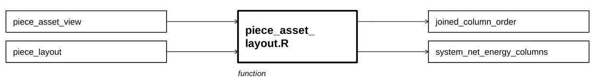

# piece_asset_layout.R

**Function** &nbsp;·&nbsp; `30_Simulation/03_Functions/piece_asset_layout.R`

## Function

Gives the layout of the view of one asset of a piece: where each column of the view comes from. A view (piece_asset_view()) and an absorb (piece_absorb_asset()) take columns by position with this layout, instead of matching about a hundred column names every time. The columns of the view are in the order that joined_column_order() gives. A column of the table of the asset, the net electricity included, is taken from that table. Time and every other column are taken from the table of the system. The layout is a list with these elements:

- asset_columns: the names of the table of the asset, time included, that the layout was built for.
- view_columns: the names of the view, in order.
- view_index: the position of each column of the view in the list of the columns of the system followed by the columns of the asset.
- own_columns: the columns of the asset, without time.
- own_in_view: the position of each own column in the view.
- net_columns: the own columns that are the net electricity of the system (system_net_energy_columns()) and that the system also holds.

Its internal objects are removed with rm(list = ), which does not call match.call() as rm() with names does: this function runs several times for every candidate of the genetic algorithm.

## Called by

- [piece_asset_view.R](piece_asset_view.md)
- [piece_layout.R](piece_layout.md)

## What it calls, in order of appearance

- [joined_column_order.R](joined_column_order.md)
- [system_net_energy_columns.R](system_net_energy_columns.md)

## Input data

- system_columns : Character vector. The names of the table of the system of the piece.
- asset_columns  : Character vector. The names of the table of the asset, time included.
- column_order   : Character vector. The order of the columns of the view (parameters$joined_cols).

## Output data

- List. The layout described above.

## Other notes from the file header

### Code outline

1. The columns of the view, in order
2. Where each column of the view comes from
3. The layout

### Usage instructions

```r
layout <- piece_asset_layout(names(piece$system),
  names(piece$assets$Building_001$df),
  parameters$joined_cols)
```

## Diagram



Also available as [piece_asset_layout.svg](piece_asset_layout.svg).

---

[Back to the code structure index](../Code_Structure.md)
