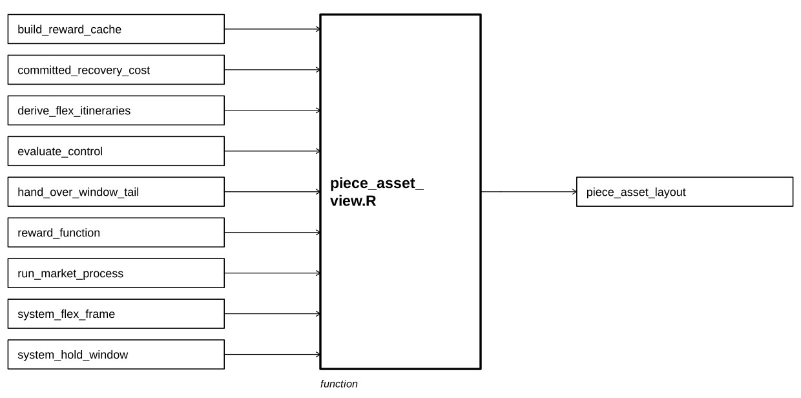

# piece_asset_view.R

**Function** &nbsp;·&nbsp; `30_Simulation/03_Functions/piece_asset_view.R`

## Function

Gives the view of one asset of a piece: one plain data frame that joins the table of the system and the table of the asset, over all the rows of the piece. It is the table that the operations of the type of model of the asset work on (see join_asset_tables()), with the row names of the table of the system of the piece. It is the table that join_asset_tables() gives over every row of the piece. The view is built from the whole columns of the tables of the piece, without copying them: R copies a column only when it is modified, so a write into the view never reaches the piece. For the same reason a view shall never be written with data.table::set(), which modifies the columns in place. The position of each column comes from the layout of the piece (piece_layout()) when it still describes the tables of the piece, and is worked out from the names of the tables otherwise (piece_asset_layout()). The structure of the piece is described in build_market_piece(). Its internal objects are removed with rm(list = ), which does not call match.call() as rm() with names does: this function runs several times for every candidate of the genetic algorithm.

## Called by

- [build_reward_cache.R](build_reward_cache.md)
- [committed_recovery_cost.R](committed_recovery_cost.md)
- [derive_flex_itineraries.R](derive_flex_itineraries.md)
- [evaluate_control.R](evaluate_control.md)
- [hand_over_window_tail.R](hand_over_window_tail.md)
- [reward_function.R](reward_function.md)
- [run_market_process.R](run_market_process.md)
- [system_flex_frame.R](system_flex_frame.md)
- [system_hold_window.R](system_hold_window.md)

## What it calls, in order of appearance

- [piece_asset_layout.R](piece_asset_layout.md)

## Input data

- piece        : List. The piece of a market.
- asset_id     : Character scalar. The asset to give the view of.
- column_order : Character vector. The order of the columns of the view (parameters$joined_cols).

## Output data

- Data frame. The columns of the system and of the asset, each once, one row per row of the piece.

## Other notes from the file header

### Code outline

1. Check the asset
2. The layout of the view
3. Join the system and the asset

### Usage instructions

```r
view <- piece_asset_view(piece, "Building_001", parameters$joined_cols)
```

## Diagram



Also available as [piece_asset_view.svg](piece_asset_view.svg).

---

[Back to the code structure index](../Code_Structure.md)
