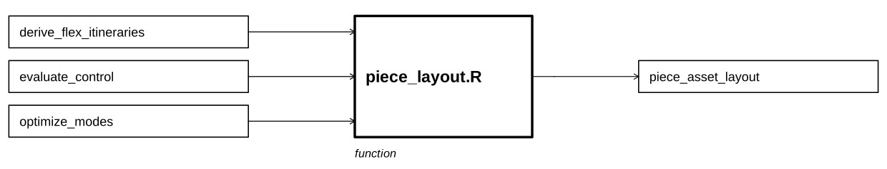

# piece_layout.R

**Function** &nbsp;·&nbsp; `30_Simulation/03_Functions/piece_layout.R`

## Function

Gives a piece with the layout of the view of each of its assets (see piece_asset_layout()), in the element layout. The layout is optional: a piece without it works the same, only slower. It is worth computing before a loop that takes many views of a piece whose columns do not change, such as the evaluation of the candidates of the genetic algorithm. The layout is checked at every use: a view or an absorb uses it only if the names of the tables and the column order are those it was built for, and works the positions out again otherwise. So a function that changes the columns of a table does not need to update it, and a stale layout can never change a result. A piece whose layout still describes it is returned untouched. The structure of the piece is described in build_market_piece(). Its internal objects are removed with rm(list = ), which does not call match.call() as rm() with names does.

## Called by

- [derive_flex_itineraries.R](derive_flex_itineraries.md)
- [evaluate_control.R](evaluate_control.md)
- [optimize_modes.R](optimize_modes.md)

## What it calls, in order of appearance

- [piece_asset_layout.R](piece_asset_layout.md)

## Input data

- piece        : List. The piece of a market.
- column_order : Character vector. The order of the columns of the views (parameters$joined_cols).

## Output data

- List. The piece, with the element layout:
    - column_order: the column order it was built for.
    - system_columns: the names of the table of the system.
    - assets: one layout (piece_asset_layout()) per asset.

## Other notes from the file header

### Code outline

1. Keep a layout that still describes the piece
2. Lay out the view of each asset

### Usage instructions

```r
piece <- piece_layout(piece, parameters$joined_cols)
```

## Diagram



Also available as [piece_layout.svg](piece_layout.svg).

---

[Back to the code structure index](../Code_Structure.md)
