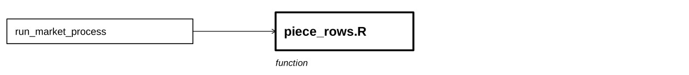

# piece_rows.R

**Function** &nbsp;·&nbsp; `30_Simulation/03_Functions/piece_rows.R`

## Function

Cuts a piece of a market by rows: every table of the piece, the table of the system and the table of each asset, keeps the same rows. The cut is made with the indexing of a data frame, so the row names are the ones that cutting a single joined table by the same rows gives (for example the rows i_begin_horizon to i_end_horizon of the period). It keeps the layout of the piece, if any: the columns do not change. The structure of the piece is described in build_market_piece().

## Called by

- [run_market_process.R](run_market_process.md)

## What it calls, in order of appearance

- Nothing: this piece calls no other piece of the project.

## Input data

- piece : List. The piece of a market, as build_market_piece() returns it.
- rows  : Integer vector. The rows to keep, rows of every table of the piece alike.

## Output data

- List. The piece with the rows asked.

## Other notes from the file header

### Code outline

1. Cut the table of the system
2. Cut the table of each asset

### Usage instructions

```r
optimization_piece <- piece_rows(piece, i_begin:i_end)
```

## Diagram



Also available as [piece_rows.svg](piece_rows.svg).

---

[Back to the code structure index](../Code_Structure.md)
