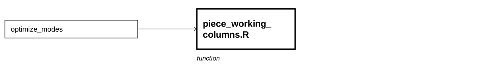

# piece_working_columns.R

**Function** &nbsp;·&nbsp; `30_Simulation/03_Functions/piece_working_columns.R`

## Function

Adds to the table of the system of a market piece the working columns of the market: the columns an evaluation of a candidate writes there and Main_df does not hold. They are:

- the net electricity of the two flexibility itineraries, written by derive_flex_itineraries()
- the phases of the flexibility windows, written by derive_flex_itineraries()
- the number of legs held, written by evaluate_control()
- the terms of the reward and Reward, written by reward_function()

An evaluation writes every one of them whole, so the value they hold before it is never read. They are added once, before the genetic algorithm, so that the layout of the views (piece_layout()) describes the piece in every evaluation, which then adds no column to it. The columns are declared in the order an evaluation creates them on a piece that holds none, so a piece prepared here and one that is not hold the same columns in the same order after an evaluation. No result depends on that order. A column the piece already holds is kept as it is. A column an evaluation writes and this list does not declare changes no result: the views are laid out again, at a cost in time.

## Called by

- [optimize_modes.R](optimize_modes.md)

## What it calls, in order of appearance

- Nothing: this piece calls no other piece of the project.

## Input data

- piece : List. The piece of a market, as build_market_piece() gives it.

## Output data

- List. The piece with every working column in the table of the system, with 0 on every row of those it did not hold.

## Other notes from the file header

### Code outline

1. The working columns
2. Add those the table of the system lacks

### Usage instructions

```r
piece <- piece_working_columns(piece = piece)
```

## Diagram



Also available as [piece_working_columns.svg](piece_working_columns.svg).

---

[Back to the code structure index](../Code_Structure.md)
