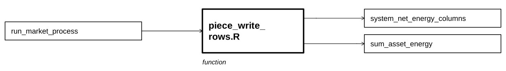

# piece_write_rows.R

**Function** &nbsp;·&nbsp; `30_Simulation/03_Functions/piece_write_rows.R`

## Function

Writes some columns of a piece of a market into another piece, table by table: the rows source_rows of source go to the rows rows of piece. A column that the table of an asset holds is written in the table of each asset that holds it. When it is the net electricity of the system in an itinerary (system_net_energy_columns()) and the table of the system holds it too, it is written again as the sum over the assets (sum_asset_energy()). Any other column is a column of the system: it is written in the table of the system, and created there first when it does not exist yet. The structure of the piece is described in build_market_piece().

## Called by

- [run_market_process.R](run_market_process.md)

## What it calls, in order of appearance

- [system_net_energy_columns.R](system_net_energy_columns.md)
- [sum_asset_energy.R](sum_asset_energy.md)

## Input data

- piece       : List. The piece written.
- rows        : Integer vector. The rows of piece to write.
- source      : List. The piece read.
- source_rows : Integer vector. The rows of source to read, as many as rows.
- columns     : Character vector. The columns to write.

## Output data

- List. The piece with the columns written.

## Other notes from the file header

### Code outline

1. Write each column in the table that holds it

### Usage instructions

```r
piece <- piece_write_rows(
  piece       = piece,
  rows        = idx_ctrl,
  source      = optimization_piece,
  source_rows = idx_inject,
  columns     = inject_cols
  )
```

### Exceptions and special cases

- A column that no table of the source holds stops the run.

## Diagram



Also available as [piece_write_rows.svg](piece_write_rows.svg).

---

[Back to the code structure index](../Code_Structure.md)
