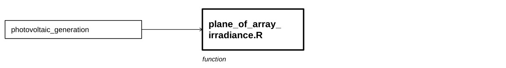

# plane_of_array_irradiance.R

**Function** &nbsp;·&nbsp; `30_Simulation/05_Models/02_Photovoltaic/03_Functions/plane_of_array_irradiance.R`

## Function

Turns the solar radiation on the horizontal plane into the solar radiation on the plane of the modules of a photovoltaic installation. It is a step of the photovoltaic model: photovoltaic_generation() calls it on the rows of a chunk, with the geometry that photovoltaic_solar_geometry() wrote in the table of the installation. The series only holds the global radiation on the horizontal plane, so it is split first, with a deliberately simple rule that has one parameter, and then each part is projected on the plane of the modules. The rule creates no radiation and loses none: the direct part and the diffuse part on the horizontal plane always add up to the radiation of the row. The divisions by 2 of the sky and ground terms belong to the isotropic sky model, and the conversion from degrees to radians is structural: they are not parameters of the simulation.

## Called by

- [photovoltaic_generation.R](photovoltaic_generation.md)

## What it calls, in order of appearance

- Nothing: this piece calls no other piece of the project.

## Input data

- G                 : Numeric vector. Global solar radiation on the horizontal plane (W/m2).
- sun_elevation     : Numeric vector. Elevation of the sun (deg).
- cos_incidence     : Numeric vector. Cosine of the angle of incidence of the rays on the modules (-).
- tilt              : Number. Tilt of the modules (deg).
- albedo            : Number. Share of the radiation that the ground reflects (-).
- diffuse_threshold : Number. Radiation counted as diffuse (W/m2).
- min_sun_elevation : Number. Elevation of the sun below which all the radiation is diffuse (deg).
- solar_constant    : Number. Limit of the direct normal irradiance (W/m2).

## Output data

- Data frame, one row per element of G, with the columns:
- B_h: direct radiation on the horizontal plane (W/m2).
- D_h: diffuse radiation on the horizontal plane (W/m2).
- DNI: direct normal irradiance (W/m2).
- G_poa: radiation on the plane of the modules (W/m2).

## Other notes from the file header

### The model

With G the global radiation on the horizontal plane (W/m2), e the elevation of the sun, cos_incidence the cosine of the angle of incidence on the modules, beta their tilt and rho the albedo:

1. G <- pmax(G, 0) A negative radiation, which a forecast may give, has no physical meaning.
2. Split on the horizontal plane. If e < min_sun_elevation, all the radiation is diffuse. Otherwise the radiation above diffuse_threshold is direct: B_h <- pmax(G - diffuse_threshold, 0) DNI <- pmin(B_h / sin(e), solar_constant) B_h <- DNI * sin(e) D_h <- G - B_h DNI is the direct normal irradiance. It is limited by the solar constant, and B_h is computed again from the limited value.
3. Projection on the plane of the modules: G_poa <- DNI * pmax(cos_incidence, 0) + D_h * (1 + cos(beta)) / 2 + G * rho * (1 - cos(beta)) / 2 The direct part is the one that the geometry of the sun changes, and it does not enter when the sun is behind the modules. The diffuse part follows the isotropic sky model and the third term is the radiation reflected by the ground. With beta = 0, G_poa is G.

### Code outline

1. Split the radiation on the horizontal plane
2. Project it on the plane of the modules

### Usage instructions

```r
irradiance <- plane_of_array_irradiance(
  G                 = G,
  sun_elevation     = sun_elevation,
  cos_incidence     = cos_incidence,
  tilt              = 30,
  albedo            = 0.2,
  diffuse_threshold = 150,
  min_sun_elevation = 5,
  solar_constant    = 1361
  )
```

## Diagram



Also available as [plane_of_array_irradiance.svg](plane_of_array_irradiance.svg).

---

[Back to the code structure index](../Code_Structure.md)
