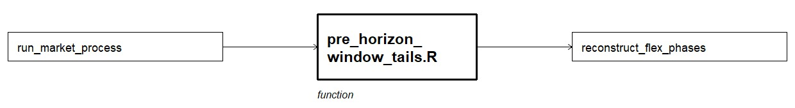

# pre_horizon_window_tails.R

**Function** &nbsp;·&nbsp; `30_Simulation/03_Functions/pre_horizon_window_tails.R`

## Function

Finds, for each flexibility leg, the windows already committed whose Commitment Phase starts in the simulated stretch of a market, between i0 and i_begin_horizon, and returns the row where the last of them ends: the end of its Recovery Phase. A window like that started before the market optimizes anything, but its Neutral and Recovery Phases may run into the optimization horizon. The market has to rebuild it whole, and it may not start a new window of the same leg until it is over.

## Called by

- [run_market_process.R](run_market_process.md)

## What it calls, in order of appearance

- [reconstruct_flex_phases.R](reconstruct_flex_phases.md)

## Input data

- period_chunk    : Data frame starting at i0 (row 1). Must contain time, MarketUTC and the committed energy columns Elec_flex_down_plan and Elec_flex_up_plan.
- i_begin_horizon : Integer. Row of period_chunk where the optimization horizon starts.
- parameters      : Named list. Used by reconstruct_flex_phases().

## Output data

- Named list with one integer per leg, down and up: the last row of period_chunk occupied by a window of that leg whose Commitment Phase starts before i_begin_horizon. 0 when there is none.

## Other notes from the file header

### Code outline

1. Phases of each leg, and the windows that start before the horizon

### Usage instructions

```r
tails <- pre_horizon_window_tails(period_chunk, i_begin_horizon, parameters)
```

## Diagram



Also available as [pre_horizon_window_tails.svg](pre_horizon_window_tails.svg).

---

[Back to the code structure index](../Code_Structure.md)
