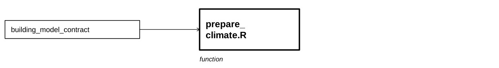

# prepare_climate.R

**Function** &nbsp;·&nbsp; `30_Simulation/05_Models/01_Building/03_Functions/prepare_climate.R`

## Function

Generates the Overall_Climate of a building, in its table, on a daily basis from Main_df$Text and the operational temperature corrections of the building. The weather is common to every asset, in Main_df; the season thresholds are those of the building. It is the operation prepare_year of the contract of the type Building (see model_type_contract()). It is meant to run before the period is cut (see subset_period.R), so that the trailing periods of the first days of a short run have the whole year to look at. A day is tagged "Heating" only when every one of the preceding HDD_period individual 24h periods has its own mean Text below T_ref_Heating_Season - not when their HDD_period-day trailing average does. "Cooling" is the equivalent check against T_ref_Cooling_Season with CDD_period 24h periods and a mean above the threshold. Any day failing both is "Intermediate". A day whose preceding periods reach back before the first day of the series has no full history. Its verdict is taken over the first periods of the series instead: with HDD_period = 7, every day of the first week is tagged from the means of the first 7 days of the series. A series shorter than the periods leaves those days "Intermediate". Each 24h period's mean is computed with cumulative sums over Main_df$time (sorted, strictly increasing) plus findInterval() to locate its row range in O(log rows) - equivalent to, but avoids, rescanning the full Main_df$time vector once per day and per 24h period (which is O(days x period x rows) and measurably slower over a full year at 5' resolution). Verified against a per-day boolean-scan implementation over randomized series, including fractional HDD_period/CDD_period, missing whole days, and series shorter than the window.

## Called by

- [building_model_contract.R](building_model_contract.md)

## What it calls, in order of appearance

- Nothing: this piece calls no other piece of the project.

## Input data

- Main_df                             : data frame, with its time and Text columns.
- asset_df                            : data frame, the table of the building, one row per row of Main_df, with its time column.
- asset                               : List. The parameters of the building, its entry of parameters$assets. This function reads its group operational_temperature_corrections: the season reference temperatures and the number of trailing periods each verdict is taken over:
    - HDD_period
    - CDD_period
    - T_ref_Heating_Season
    - T_ref_Cooling_Season

## Output data

- asset_df, as received, with the column Overall_Climate added: one verdict per row, Heating, Cooling or Intermediate, held constant over the calendar day.

## Other notes from the file header

### Code outline

1. Resolve the daily mean of Text.
2. Tag a day Heating when every one of the preceding periods is below the heating reference, Cooling on the mirror test. A day with no full history takes the first periods of the series.
3. Spread the daily verdict over every row of its day.

### Usage instructions

```r
asset_df <- prepare_climate(
  Main_df                             = Main_df,
  asset_df                            = asset_df,
  asset                               = parameters$assets[[1]]
  )
```

## Diagram



Also available as [prepare_climate.svg](prepare_climate.svg).

---

[Back to the code structure index](../Code_Structure.md)
