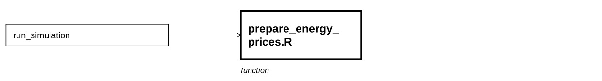

# prepare_energy_prices.R

**Function** &nbsp;·&nbsp; `30_Simulation/03_Functions/prepare_energy_prices.R`

## Function

Derives the twelve buy/sell price signals (four for energy, eight for flexibility) that prepare_market_information() and the rest of the market/reward pipeline consume, from the signals already present in Main_df at this point:

- Elec_unit_cost_buy: real input data (from Energy_Prices_df), never overwritten by this function; the sole reference price (P_ref) for the four energy signals below.
- The four flexibility prices, either real input data or overwritten by prepare_flexibility_prices() just before this function runs:
    - Flex_unit_cost_down_com
    - Flex_unit_cost_down_exec
    - Flex_unit_cost_up_com
    - Flex_unit_cost_up_exec

The four energy signals implement this discount formula, using energy_price (Energy_Export_discount/Energy_Sell_discount/Price_variation_*):

- import_buy  = P_ref * factor_tiempo
- import_sell = import_buy * (1 - Sell_discount/100)
- export_buy  = P_ref * factor_tiempo * (1 - Export_discount/100)
- export_sell = export_buy * (1 - Sell_discount/100)

These flat Main_df columns are the row-level ("now") prices used by settle_execution.R's execution-phase economic accounting, so factor_tiempo here always uses h = 0 (the "below_1h" tier of the 4-tier partition of Price_variation_in_time - see price_variation_at_lead()). The GA-facing prices, per market event and per future step (h = j * market_resolution/60, j > 0 included), are computed separately, cell by cell, in prepare_market_information() - these flat columns are NOT averaged into its energy matrices the way the other nine signals are (see its header). The eight flexibility columns are unconditional buy/sell duplicates of the four flexibility prices.

## Called by

- [run_simulation.R](run_simulation.md)

## What it calls, in order of appearance

- Nothing: this piece calls no other piece of the project.

## Input data

- Main_df      : data frame, carrying the input price signal Elec_unit_cost_buy and the four flexibility prices.
- energy_price : List, parameters$energy_price. The discounts and the variation of each price with the horizon it is quoted at:
    - Energy_Export_discount [%]
    - Energy_Sell_discount [%]
    - Price_variation_below_1h [%]

## Output data

- Main_df, as received, with the twelve derived price signals: four for energy and eight for flexibility, buy and sell of each.

## Other notes from the file header

### Code outline

1. Derive the three remaining energy prices from the input one.
2. Derive the eight flexibility prices from the four flexibility prices, as buy and sell duplicates.

### Usage instructions

```r
Main_df <- prepare_energy_prices(
  Main_df      = Main_df,
  energy_price = parameters$energy_price
  )
```

## Diagram



Also available as [prepare_energy_prices.svg](prepare_energy_prices.svg).

---

[Back to the code structure index](../Code_Structure.md)
