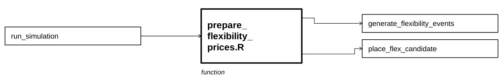

# prepare_flexibility_prices.R

**Function** &nbsp;·&nbsp; `30_Simulation/03_Functions/prepare_flexibility_prices.R`

## Function

Emulates the flexibility market when there is no real data for it: decides where and when flexibility events happen, and overwrites the flexibility price and probability columns of Main_df with generated values for them. Main.R calls it only when parameters$debug_and_config$Price_emulation == 1, so the events exist before any market can sell flexibility on them.
Columns overwritten in Main_df:

- Flex_unit_cost_down_com  - flexibility commitment price (down), EUR/kWh
- Flex_unit_cost_down_exec - flexibility execution price (down), EUR/kWh
- Flex_unit_cost_up_com    - flexibility commitment price (up), EUR/kWh
- Flex_unit_cost_up_exec   - flexibility execution price (up), EUR/kWh
- Flex_Probab_down         - downward flexibility execution probability (0-1)
- Flex_Probab_up           - upward flexibility execution probability (0-1)
- Flex_Act                 - 1 for every row covered by an accepted flexibility event, 0 otherwise

An event covers the rows whose market interval (MarketUTC) it spans, which are the rows whose time step falls inside it.

## Called by

- [run_simulation.R](run_simulation.md)

## What it calls, in order of appearance

- [generate_flexibility_events.R](generate_flexibility_events.md)
- [place_flex_candidate.R](place_flex_candidate.md)

## Input data

- Main_df                     : data frame. Must contain time, MarketUTC and, in complex mode, the Sched_*/Pilot_* market timeline columns.
- market                      : List, parameters$market:
    - market_resolution
    - Complex_Market_Config
    - the Max_flex_* limits
- flexibility_price_emulation : List, parameters$flexibility_price_emulation. Used in complex mode only.
- computing                   : List, parameters$computing. Used in complex mode only.

## Output data

- Main_df, as received, with the flexibility price, probability and activation columns overwritten with the generated values.

## Other notes from the file header

### Two modes

Both place the start and the duration of every event on slots of market$market_resolution.

- Complex_Market_Config == "no" (basic): one independent candidate per period and calendar day, placed anywhere in the day's [0, 24 h) window by place_flex_candidate(), with these parameters of market:
- Max_flex_periods_day
- Max_flex_com_price
- Max_flex_exec_price
- Max_flex_period_duration
- Max_flex_probability_down
- Max_flex_probability_up

Complex_Market_Config == "yes" (market-aware): delegates to

- generate_flexibility_events(), whose header describes the full
- algorithm:
- Scheduling echo and candidates
- Piloting candidates with exponential decay

The random numbers are drawn in a fixed order, so a run with a fixed seed generates the same events every time.

### Code outline

1. Draw the flexibility events of the whole period, place each on the calendar and write the resulting events into Main_df.

### Usage instructions

```r
Main_df <- prepare_flexibility_prices(
  Main_df                     = Main_df,
  market                      = parameters$market,
  flexibility_price_emulation = parameters$flexibility_price_emulation,
  computing                   = parameters$computing
  )
```

## Diagram



Also available as [prepare_flexibility_prices.svg](prepare_flexibility_prices.svg).

---

[Back to the code structure index](../Code_Structure.md)
