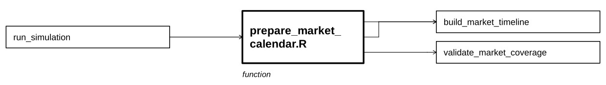

# prepare_market_calendar.R

**Function** &nbsp;·&nbsp; `30_Simulation/03_Functions/prepare_market_calendar.R`

## Function

Assigns every row of Main_df to its market interval (MarketUTC), and initialises and populates the Sched_* and Pilot_* market columns of Main_df. Supports two modes:

- Basic  (Complex_Market_Config == "no") : deterministic market timeline from optimisation horizons.
- Complex (Complex_Market_Config == "yes") : timeline built from the market-config tables. In complex mode, the optimization horizon is computed from end_optimization.

It runs after the month/period subset and before the price emulation, and before every step that asks which markets are active.

## Called by

- [run_simulation.R](run_simulation.md)

## What it calls, in order of appearance

- [build_market_timeline.R](build_market_timeline.md) &nbsp;(2 call sites)
- [validate_market_coverage.R](validate_market_coverage.md)

## Input data

- Main_df                  : data frame, with its time column.
- computing                : List, parameters$computing. Uses main_resolution_sec, the time step [s].
- market                   : List, parameters$market. The market resolution, the mode and the basic horizons of Scheduling and Piloting.
- market_config_scheduling : data frame, parameters$market_config_scheduling, the markets of the complex mode.
- market_config_piloting   : data frame, parameters$market_config_piloting, the markets of the complex mode.

## Output data

- Main_df, as received, with:
    - MarketUTC, the market interval of each row's time step (POSIXct, UTC)
    - the Sched_ and Pilot_ market columns, for the market that clears on each row:
        - the name
        - the bid time
        - the period bounds
        - the horizon
        - the aim

## Other notes from the file header

### Rows and market intervals

A row holds the state of the building at its instant and the energy of the time step that ends at that instant. Each row is therefore assigned to the market interval that contains its time step, i.e. the interval of the instant one step earlier. With this rule the energy of a market interval is exactly the energy of the time steps that fall inside it, and every price, commitment and settlement read per interval applies to that energy. The first row is the initial condition of the simulation. Its time step lies before the simulation, so its interval is the one before the first instant, and it holds no energy. A market clearing is an event at an instant, and it is keyed by the interval its instant falls in (instant_market_slot()).

### Code outline

1. Assign every row to the market interval of its time step.
2. Initialise both sets of market columns to their empty value.
3. Build the timeline of each role, from the horizons in the basic mode or from the configuration table in the complex one.
4. Check that a market covers every market interval.

### Usage instructions

```r
Main_df <- prepare_market_calendar(
  Main_df                  = Main_df,
  computing                = parameters$computing,
  market                   = parameters$market,
  market_config_scheduling = parameters$market_config_scheduling,
  market_config_piloting   = parameters$market_config_piloting
  )
```

## Diagram



Also available as [prepare_market_calendar.svg](prepare_market_calendar.svg).

---

[Back to the code structure index](../Code_Structure.md)
