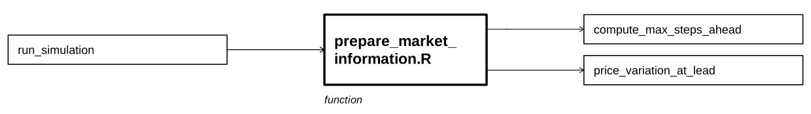

# prepare_market_information.R

**Function** &nbsp;·&nbsp; `30_Simulation/03_Functions/prepare_market_information.R`

## Function

Builds the future-horizon price matrices used by the market processes (Scheduling and Piloting) to look up energy and flexibility prices at each market step. Each price signal is stored as a data frame with one row per market event (a row where a Scheduling or Piloting market actually clears, i.e. Main_df$Sched_Market_Name or Main_df$Pilot_Market_Name is active there) and one column per future step ahead of that event, named "0" (the event's own interval) to as.character(max_steps_ahead - 1). An event is keyed by the market interval its instant falls in (instant_market_slot()), and column step j refers to the market-resolution grid interval j steps ahead of that interval, so j steps are also the lead of the interval from the clearing. The thirteen data frames are bundled into a single named list, full_market_information (e.g. full_market_information$Elec_unit_cost_import_buy_df). Nine of the thirteen signals (Elec_unit_cost_distribution, used only by reward_function() via resolve_marginal_context(), and the eight flexibility buy/sell signals) are pass-through: the value assigned to a MarketUTC interval is simply the mean of the Main_df signal over all observations sharing that interval (step 3), then looked up per future step (step 5). The remaining four (Elec_unit_cost_import/export_buy/sell) are NOT averaged from a flat Main_df column - they are computed cell by cell from Elec_unit_cost_buy (P_ref) using the discount formula given in prepare_energy_prices() and energy_price, because factor_tiempo depends on h = j * market_resolution/60 (j = future-step column), which is not a property of a single Main_df row - see step 5. A flat per-row column therefore cannot represent this signal. The future-step column width (max_steps_ahead) is the distance from the bid time of the furthest-looking market to the end of its optimization horizon, in market_resolution steps. It is read from the market configuration in use (the basic markets of 03_Market_config.csv, or the market tables in complex mode) by compute_max_steps_ahead().

## Called by

- [run_simulation.R](run_simulation.md)

## What it calls, in order of appearance

- [compute_max_steps_ahead.R](compute_max_steps_ahead.md)
- [price_variation_at_lead.R](price_variation_at_lead.md)

## Input data

- Main_df                  : data frame, with MarketUTC, its market columns and its twelve price signals.
- market_events            : Data frame. The market events of the run, as build_market_events() returns them. Uses event_slot.
- market                   : List, parameters$market. The market resolution and the horizons.
- market_config_scheduling : data frame, parameters$market_config_scheduling, the markets of the complex mode.
- market_config_piloting   : data frame, parameters$market_config_piloting, the markets of the complex mode.
- energy_price             : List, parameters$energy_price. The discounts and the variation of each price with the horizon it is quoted at.
- computing                : List, parameters$computing. The lead edges of the four price bands.

## Output data

- full_market_information, a list of data frames, one per price signal, with one row per market event and one column per step ahead.

## Other notes from the file header

### Code outline

1. Determine the furthest horizon any market looks at.
2. Build the market-resolution grid and locate the market events.
3. Average each price signal over every market interval.
4. Create the horizon data frames, with every cell missing (NA).
5. Fill them from those averages, discounted to the horizon.

### Usage instructions

```r
full_market_information <- prepare_market_information(
  Main_df                  = Main_df,
  market                   = parameters$market,
  market_config_scheduling = parameters$market_config_scheduling,
  market_config_piloting   = parameters$market_config_piloting,
  energy_price             = parameters$energy_price,
  computing                = parameters$computing
  )
```

## Diagram



Also available as [prepare_market_information.svg](prepare_market_information.svg).

---

[Back to the code structure index](../Code_Structure.md)
