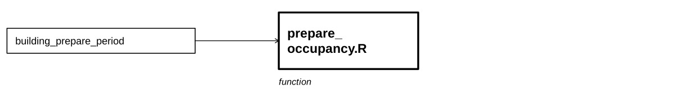

# prepare_occupancy.R

**Function** &nbsp;·&nbsp; `30_Simulation/05_Models/01_Building/03_Functions/prepare_occupancy.R`

## Function

Generates the Occupancy of a building, in its table, from its use patterns. A row holds the state of the building at its instant and the energy of the time step that ends at that instant, so its occupancy is the one of that time step: it is read at the start of the step, one step before the instant of the row, as the prices and the flexibility events are. The start of each step is mapped to a MONTH row, a weekday column and an hourly TYPE value, in UTC. The column Hnn of a day type is the hour that ends at nn:00 of its date: H01 is the hour from 00:00 to 01:00 and H24 the hour from 23:00 to 24:00. With a step of 5 minutes, the row at 07:00 (the step from 06:55 to 07:00) reads H07, and the row at 07:05 reads H08. The time step is the interval between the rows of the table, which shall be regular. The result is needed before the scheduling profile and the reference temperature profiles can be computed.

## Called by

- [building_prepare_period.R](building_prepare_period.md)

## What it calls, in order of appearance

- Nothing: this piece calls no other piece of the project.

## Input data

- asset_df     : data frame, the table of the building, with its time column, at least two rows and a regular time step.
- use_patterns : List, the use_patterns of the building (its entry of parameters$assets). The occupancy table, by month, weekday and hour:
    - day_types: one row per TYPE, one column per hour
    - month_profiles: one row per MONTH, one column per weekday

## Output data

- asset_df, as received, with the column Occupancy added: one integer value (0 or 1) per row.

## Other notes from the file header

### Code outline

1. Map the start of the step of each row to its month row, weekday column and hour.
2. Read the occupancy of that cell.
3. Check the occupancy and write it into asset_df.

### Usage instructions

```r
asset_df <- prepare_occupancy(
  asset_df     = asset_df,
  use_patterns = parameters$assets[[1]]$use_patterns
  )
```

## Diagram



Also available as [prepare_occupancy.svg](prepare_occupancy.svg).

---

[Back to the code structure index](../Code_Structure.md)
