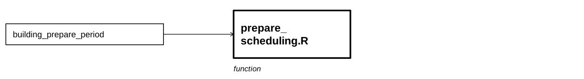

# prepare_scheduling.R

**Function** &nbsp;·&nbsp; `30_Simulation/05_Models/01_Building/03_Functions/prepare_scheduling.R`

## Function

Generates the Scheduling of a building, in its table, from its Occupancy and the anticipation parameters of its operational temperature corrections. For each calendar day with at least one occupied row, computes one [interval_begin, interval_end] window and marks Scheduling = 1 over it:

- interval_begin is the time of the first occupied row minus Service_Anticipation_Begin;
- interval_end is the time of the last occupied row minus Service_Anticipation_End: the window ends before the occupancy does.

The calendar day of a row is the UTC date of the start of its time step, as for its occupancy (prepare_occupancy()): the row at 00:00 closes the step from 23:55 to 24:00 with a step of 5 minutes, and belongs to the day before. The time step is the interval between the rows of the table, which shall be regular. Window boundaries are located in the sorted asset_df$time vector via findInterval() (O(log rows) per day) instead of a per-day full boolean scan of asset_df$time, which would be O(days x rows) and measurably slower over a full year at fine time resolution; only the resulting row ranges are then written to 1, so the total assignment cost stays O(rows) across all days combined instead of being repeated per day.

## Called by

- [building_prepare_period.R](building_prepare_period.md)

## What it calls, in order of appearance

- Nothing: this piece calls no other piece of the project.

## Input data

- asset_df                            : data frame, the table of the building, with its time and Occupancy columns, at least two rows and a regular time step.
- operational_temperature_corrections : List. The anticipation applied to the start and the end of each occupied stretch, those of the building, in its entry of parameters$assets:
    - Service_Anticipation_Begin [h]
    - Service_Anticipation_End [h]

## Output data

- asset_df, as received, with the column Scheduling added: one integer flag (0 or 1) per row, marking the window the building is prepared over.

## Other notes from the file header

### Code outline

1. Check Occupancy, read the anticipation and find the day of each row.
2. Find, for each calendar day, the first and last occupied row, shift that pair by the anticipation parameters, and mark Scheduling over the resulting window.
3. Check Scheduling.

### Usage instructions

```r
asset_df <- prepare_scheduling(
  asset_df                            = asset_df,
  operational_temperature_corrections =
  parameters$assets[[1]]$operational_temperature_corrections
  )
```

## Diagram



Also available as [prepare_scheduling.svg](prepare_scheduling.svg).

---

[Back to the code structure index](../Code_Structure.md)
