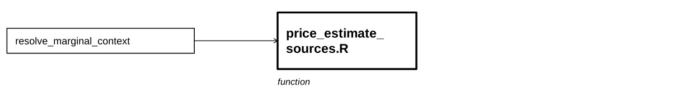

# price_estimate_sources.R

**Function** &nbsp;·&nbsp; `30_Simulation/03_Functions/price_estimate_sources.R`

## Function

Says, for every market interval of a market's optimization horizon, where its price is read from. Inside the control horizon the market publishes the price, and it is read as it is. Beyond it, the market has no price yet, and the price is estimated from what the markets already know, by these rules, in this order:

1. The price of the last earlier market that traded that interval: the market that cleared most recently before this one and whose control period holds the interval.
2. When no earlier market traded it, the price of the same interval one day before: from this market, if its control period holds that interval, or otherwise from the last earlier market that traded it.
3. When neither gives a price, the mean of the prices of the market's own control horizon.

The rules only depend on the market structure, not on the price signal, so they are resolved once per market and applied to every signal by estimate_price_signal().

## Called by

- [resolve_marginal_context.R](resolve_marginal_context.md)

## What it calls, in order of appearance

- Nothing: this piece calls no other piece of the project.

## Input data

- target_times      : POSIXct vector. The market intervals of the optimization horizon, in order.
- end_control_time  : POSIXct scalar. The last interval of the control horizon.
- event_slot        : POSIXct scalar. The interval this market's clearing instant falls in (instant_market_slot()).
- events            : Data frame. The market events of both families, as built by market_event_index(): market_num, begins_num and ends_num, in seconds since the epoch.
- market_resolution : Numeric scalar (min). Length of a market interval.

## Output data

- Data frame, one row per entry of target_times, with:
    - source      : character, one of
        - "published"
        - "earlier_market"
        - "day_before_current"
        - "day_before_earlier"
        - "current_mean"
    - event_num   : numeric, the clearing interval of the earlier market to read, in seconds since the epoch; NA for the other sources
    - column      : character, the column of the price matrices to read in that market's row; NA for the other sources
    - current_pos : integer, the position in target_times of the interval one day before, for "day_before_current"; NA for the others

## Other notes from the file header

### Earlier markets

An earlier market is one that cleared strictly before this one, of either family, Scheduling or Piloting. It traded an interval when the interval starts at or after its Period_Begin and before its Period_End. The price it had for that interval is the one in its own row of the price matrices of full_market_information, at the column of that interval.

### Code outline

1. Published intervals and earlier markets
2. Source of every interval beyond the control horizon

### Usage instructions

```r
sources <- price_estimate_sources(target_times, end_control_time,
  event_slot, events,
  market_resolution)
```

## Diagram



Also available as [price_estimate_sources.svg](price_estimate_sources.svg).

---

[Back to the code structure index](../Code_Structure.md)
