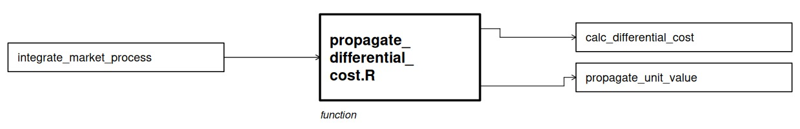

# propagate_differential_cost.R

**Function** &nbsp;·&nbsp; `30_Simulation/03_Functions/propagate_differential_cost.R`

## Function

Resolves the net cash flow of a single market/target-interval energy transaction via calc_differential_cost(), then accumulates and propagates it via propagate_unit_value() (see that function's header for the accumulation/propagation mechanics). Used for the two energy-differential-cost signals of the simulation (base energy cost for Scheduling, flex-adjusted energy cost for Piloting), which both follow the same "resolve a single import/export transition" shape. The explicit-flexibility signal does not go through this function: it values two independent down/up legs rather than a single import/export transition, so it resolves its own net cash flow via value_flex_operation() and calls propagate_unit_value() directly - see integrate_market_process.R.

## Called by

- [integrate_market_process.R](integrate_market_process.md)

## What it calls, in order of appearance

- [calc_differential_cost.R](calc_differential_cost.md)
- [propagate_unit_value.R](propagate_unit_value.md)

## Input data

- Same meaning as in propagate_unit_value():
    - row_m
    - col_j
    - mkt_target
    - cost_df
    - Main_df
    - weight_col
    - target_col
- Numeric scalars, passed straight through to calc_differential_cost()
- (see that function's header for their meaning):
    - E_orig
    - E_new
    - P_import_buy
    - P_import_sell
    - P_export_buy
    - P_export_sell

## Output data

- Named list with: Main_df : Data frame. Updated in place at target_col for the 5-minute rows of the target interval. cost_df : Data frame. Updated in place at [row_m, col_j].

## Other notes from the file header

### Code outline

1. Net cash flow of this transition
2. Accumulation and propagation via propagate_unit_value()

### Usage instructions

```r
result  <- propagate_differential_cost(row_m, col_j, mkt_target, E_orig, E_new, P_import_buy, P_import_sell, P_export_buy, P_export_sell, cost_df, Main_df, weight_col, target_col)
```

Main_df <- result$Main_df cost_df <- result$cost_df

## Diagram



Also available as [propagate_differential_cost.svg](propagate_differential_cost.svg).

---

[Back to the code structure index](../Code_Structure.md)
