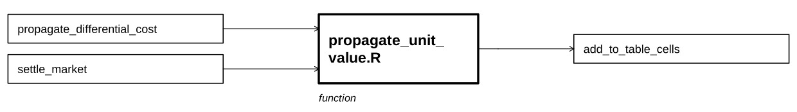

# propagate_unit_value.R

**Function** &nbsp;·&nbsp; `30_Simulation/03_Functions/propagate_unit_value.R`

## Function

Accumulates an already-resolved net cash flow (delta_C) for a single market/target-interval decision into a market-resolution cost matrix, and spreads its unit value, weighted by energy, over the 5-minute rows that share the target interval's MarketUTC. The function writes nothing into Main_df: it returns the amount to add to each of those rows, and the simulation loop writes it. This is the reusable second half of propagate_differential_cost(): that function additionally resolves delta_C itself via calc_differential_cost() for a single (E_orig, E_new, four prices) transition; this function is called directly whenever delta_C has already been resolved some other way (e.g. the down/up-leg flexibility valuation of settle_market.R, via value_flex_operation(), which is not a single import/export transition and so cannot go through calc_differential_cost()).

## Called by

- [propagate_differential_cost.R](propagate_differential_cost.md)
- [settle_market.R](settle_market.md)

## What it calls, in order of appearance

- [add_to_table_cells.R](add_to_table_cells.md)

## Input data

- row_m      : Integer. Row of the current market event in cost_df (a sparse, market-event row set; not the full market-resolution grid).
- col_j      : Character. Market-resolution column (future-step offset) of the target interval in cost_df.
- delta_C    : Numeric scalar. Net cash flow to accumulate for the target interval (positive = income, negative = expense).
- cost_df    : Data frame. Market-resolution cost matrix to accumulate delta_C into (e.g. market_commitments$Elec_flex_Cost_plan_df).
- rows_ts    : Integer vector. Rows of Main_df that belong to the target interval.
- weight_ts  : Numeric vector, as long as rows_ts. Energy position of each of those rows, used to weight the value propagation. It is a signed position; its absolute value is what is used as the weight - see block 2.

## Output data

- Named list with: cost_df : Data frame. cost_df with delta_C added at [row_m, col_j]. The addition is made in place (add_to_table_cells()), so the cost_df passed in holds it too. rows    : Integer vector. The rows of Main_df to write (rows_ts). delta   : Numeric vector, as long as rows. Amount to add to each of those rows of the target column.

## Other notes from the file header

### Code outline

1. Accumulation into cost_df
2. Unit value spread over the rows of the target interval, weighted by energy per timestamp

### Usage instructions

```r
result  <- propagate_unit_value(row_m, col_j, delta_C, cost_df,
  rows_ts, weight_ts)
```

cost_df <- result$cost_df The caller adds result$delta to the target column at result$rows.

## Diagram



Also available as [propagate_unit_value.svg](propagate_unit_value.svg).

---

[Back to the code structure index](../Code_Structure.md)
