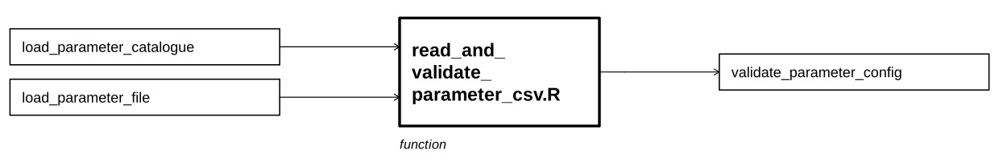

# read_and_validate_parameter_csv.R

**Function** &nbsp;·&nbsp; `30_Simulation/03_Functions/read_and_validate_parameter_csv.R`

## Function

Reads a simple parameter/value CSV configuration file and validates its raw values against the parameter catalogue. This is the common first step shared by every load_XX_*.R script that reads a plain parameter/value file (as opposed to a multi-column table such as 14_Use_Patterns.csv or the market config tables).

## Called by

- [load_parameter_catalogue.R](load_parameter_catalogue.md)
- [load_parameter_file.R](load_parameter_file.md)

## What it calls, in order of appearance

- [validate_parameter_config.R](validate_parameter_config.md)

## Input data

- path              : Character. Path to the parameter/value CSV file.
- file_name         : Character. Base name of the config file, used to look up its validation rules (e.g. "09_Reward_parameters.csv").
- validation_config : Named list. The parameter catalogue, as load_parameter_catalogue() returns it.

## Output data

- Named list. parameter_name -> raw value (character or numeric), already validated against validation_config.

## Other notes from the file header

### Code outline

1. Read the CSV file and build the named list of raw values
2. Validate that no parameter name is duplicated
3. Validate the raw values against validation_config

### Usage instructions

```r
raw_values <- read_and_validate_parameter_csv(paths$reward_file,
  "09_Reward_parameters.csv", validation_config)
```

## Diagram



Also available as [read_and_validate_parameter_csv.svg](read_and_validate_parameter_csv.svg).

---

[Back to the code structure index](../Code_Structure.md)
