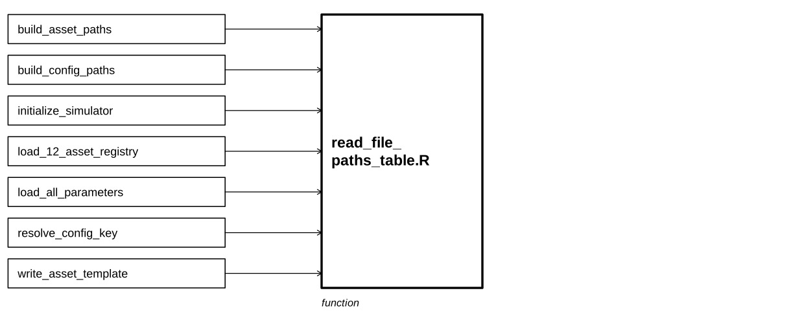

# read_file_paths_table.R

**Function** &nbsp;·&nbsp; `30_Simulation/03_Functions/read_file_paths_table.R`

## Function

Reads and checks the table of file names of a configuration folder, 00_Inner_parameters/04_File_paths.csv: the one list of file names that the simulation, the GUI and the verification battery share. Every file has a scope: "system" for a file common to the whole simulation, or the type of model (for example "Building") whose every asset holds the file.

## Called by

- [build_asset_paths.R](build_asset_paths.md)
- [build_config_paths.R](build_config_paths.md)
- [initialize_simulator.R](initialize_simulator.md)
- [load_12_asset_registry.R](load_12_asset_registry.md)
- [load_all_parameters.R](load_all_parameters.md)
- [resolve_config_key.R](resolve_config_key.md)
- [write_asset_template.R](write_asset_template.md)

## What it calls, in order of appearance

- Nothing: this piece calls no other piece of the project.

## Input data

- config_path : Character. Path of the configuration folder, the one that holds 00_Inner_parameters/.

## Output data

- Data frame with the character columns key, scope and filename, one row per file, in the order of the file. The run stops if the file lacks one of the columns, if a key, a scope or a file name is empty, or if a key is repeated.

## Other notes from the file header

### Code outline

1. Read the table
2. Check the table

### Usage instructions

```r
file_paths_table <- read_file_paths_table(
  config_path = file.path("30_Simulation", "02_Config")
  )
```

file_paths_table$filename[file_paths_table$key == "reward_file"]

## Diagram



Also available as [read_file_paths_table.svg](read_file_paths_table.svg).

---

[Back to the code structure index](../Code_Structure.md)
